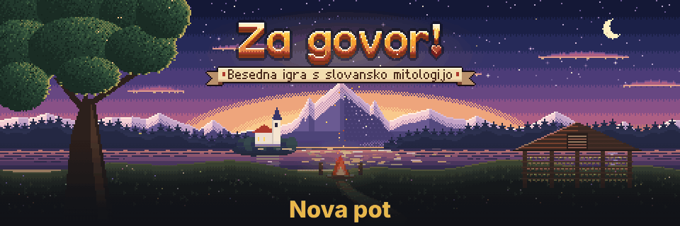
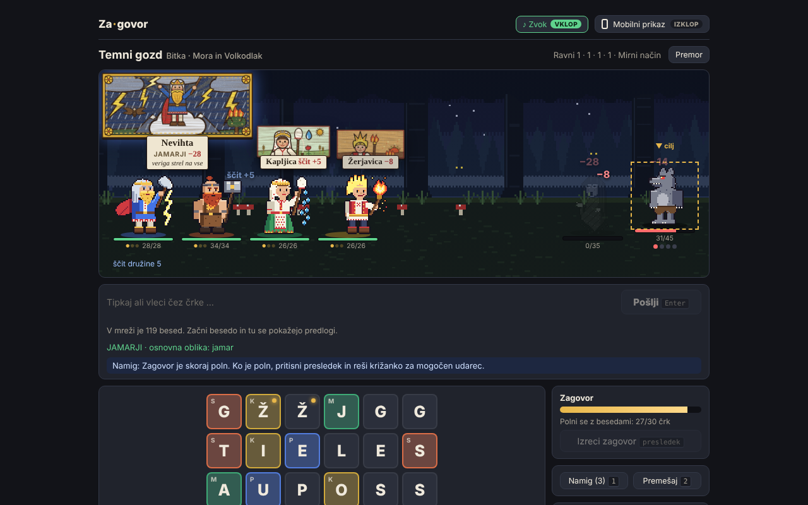
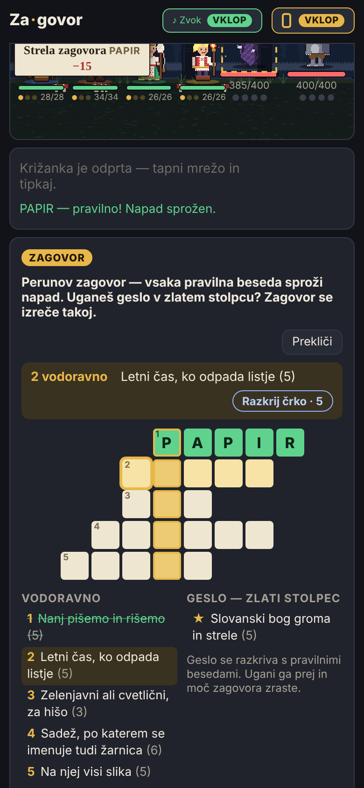
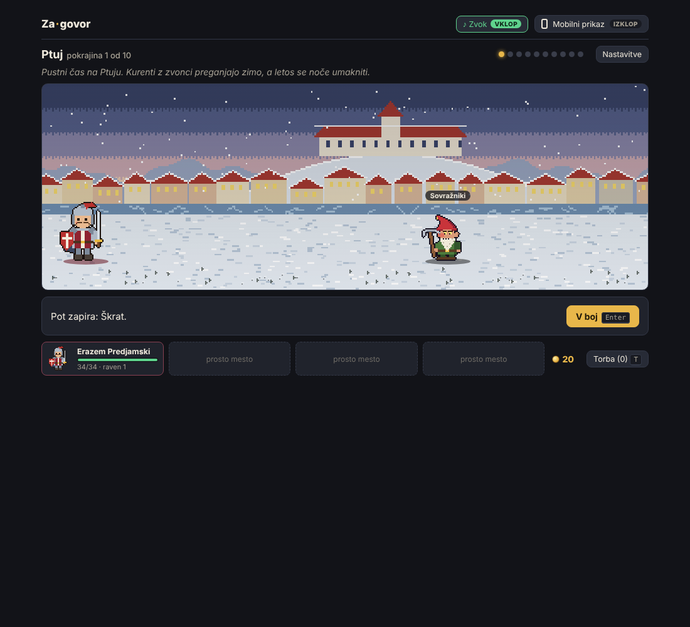

# Za govor!

<p></p>

**A Slovene word-puzzle RPG with heroes from Slavic mythology and Slovene folklore.** Walk
across Slovenia from Ptuj to Ljubljana castle, chain letters into Slovene words to make
your heroes attack, solve crosswords to speak a *zagovor* (a folk charm), and fight the
creatures of Slovene folklore on the way to the dragon. It exists to show how rich and
playful the Slovene language is.

Developed by **Oygn Productions** (Davor Kirbiš). I have an enormous passion for video games
and storytelling, and *Za govor!* is my big passion project, made to promote our beautiful
Slovene language and our fascinating folklore, the things that make us Slovene.

*Za govor!* grew out of a love for [Words for Evil](https://store.steampowered.com/app/335790/Words_for_Evil/)
(Dylan Loney, Chromosphere Games, 2014), a game that turns word puzzles into a heroic
adventure. I wanted something like it in Slovene, with our own words, places and folk heroes.
It is an independent game with its own code, art, characters and story, and is not affiliated
with or endorsed by *Words for Evil* or its creators. Thanks to Dylan Loney for the game that
inspired this journey. (This README ships with the PC versions. Inside the game, on every
platform, *O igri* names the maker and says the game grew out of playing word games, without
naming any other game, so no store or platform review can stumble on it.)

> **Slovensko:** *Za govor!* je besedna igra s prvinami igre vlog v slovenščini. Junaki iz
> slovanske mitologije se bojujejo z besedami: iz mreže črk sestavljaš besede, rešuješ
> križanke in odpiraš skrinje. Igra želi pokazati, kako bogata in igriva je slovenščina.

The name is a play on words: read as one word, *zagovor* is a spoken charm; read as two,
*za govor* means "for speech". The exclamation mark makes it a call: speak up, in Slovene.

**Status:** playable browser prototype of the whole journey and all the mini-games (one page, no install). The
full game is planned in Godot 4.7 for Windows, macOS, Linux, Android and iOS — see
[docs/platform-roadmap.md](docs/platform-roadmap.md).

<p>
  
  
</p>

<p>
  
</p>

## Contents
- [Play the prototype](#play-the-prototype)
- [Phone and Android](#phone-and-android)
- [Missing words](#missing-words)
- [How it plays](#how-it-plays)
- [Controls](#controls)
- [Build from source](#build-from-source)
- [Tests](#tests)
- [Project structure](#project-structure)
- [How the prototype works](#how-the-prototype-works)
- [Language data and sources](#language-data-and-sources)
- [Roadmap](#roadmap)
- [Known issues](#known-issues)
- [Design documents](#design-documents)
- [Licence](#licence)

## Play the prototype
Download or clone the repository and open **`dist/index.html`** in any modern browser
(Chrome, Firefox, Safari, Edge — desktop, phone or tablet). Everything, including the
46,000-word dictionary, the art and the sound, is inside that one file; no server or
internet connection is needed.

The interface is in Slovene. A phone or tablet gets the phone layout (*Mobilni prikaz*) by
itself; there is no switch. For development, add `?prikaz=telefon` or `?prikaz=namizje` to the
address to force one (Chrome's device mode is detected as a phone without it).

The version of the build is at the bottom of the start screen (`zaprta alfa · v0.8.0 · <commit>`).
See [CHANGELOG.md](CHANGELOG.md) for what each version brought and how versions are numbered.

## How it plays
**The start screen is a short menu:** *Nadaljuj pot* (while a journey is under way, with the
region it stopped in), *Nova pot*, *Dosežki in junaki*, *Kako igrati* and *O igri*. Every
page under it has **← Nazaj na glavni meni** at the top; `Esc` and the Android back button
do the same. *Nova pot* is where the difficulty is chosen (see
[Two difficulty choices](#two-difficulty-choices)), then the first hero. *Kako igrati* lists
the controls of the current device (keyboard and mouse, or touch) and shows every puzzle in a
carousel; *O igri* holds the description, the maker (*Avtor*), *Navdih*, *Pošlji besede* and the sources (*Zasluge*, folded behind ©).

The game is **one side-scrolling journey** through places in Slovenia. You choose one hero
and walk; the road stops you at enemies, chests, rock slides, wells, pedlars, shrines of
the old gods and other heroes. There is no level list — the road leads from region to region, and the dragon at
Ljubljana castle is the last battle.

| # | Region | Legend of the place | On the road |
| --- | --- | --- | --- |
| 1 | **Ptuj** | Kurent | four battles, a chest |
| 2 | **Peca** | Kralj Matjaž | three battles, a shrine (Svarog or Perun) |
| 3 | **Triglav** | Ajdovska deklica | three battles, a pedlar, a shrine (Perun or Stribog) |
| 4 | **Bled** | the old gods (an island shrine of Živa) | three battles, a shrine (Dažbog or Mokoš) |
| 5 | **Trnovski gozd** | Martin Krpan | three battles, a shrine (Veles or Mokoš) |
| 6 | **Piranske soline** | Lepa Vida | three battles, a pedlar, a shrine (Stribog or Dažbog) |
| 7 | **Predjamski grad** | Erazem Predjamski | two battles, an ambush |
| 8 | **Ljubljansko barje** | Zeleni Jurij | three battles, a pedlar, a shrine (Veles or Mokoš) |
| 9 | **Ljubljanica** | Peter Klepec | two battles, **Povodni mož** (boss) |
| 10 | **Ljubljanski grad** | — | a pedlar, **Lintvern**, the Ljubljana dragon (final boss) |

Every region also has **one chest or trap** (since 0.17.0: never both) and a place for **a well**
(Ljubljanica and Ljubljanski grad open with their chest or trap), and heroes wait in some regions.

Only **two of the six shrines** stand on any one journey (picked at random, each for a
different god, never in the last region), and only three heroes wait on the road, so no two journeys are alike. **Chests,
traps and wells are planned by chance too:** when a journey starts, each region's event becomes a
chest with a chance set by *Znanje* (60 / 45 / 30 % on Malček / Učenjak / Knjižni molj), otherwise a
rock slide or a wall of spikes; Ptuj's is always a chest. Wells stay with 75 / 55 / 40 %
(`data/world.json → chance`), and a journey always keeps a well in each half of the road.

- **Walking:** press `→` (or *Naprej*) and the party walks to the next stop; a prompt offers
  what can be done there (`Enter` for the main choice, `Esc` to walk past where that is allowed).
- **The party:** you pick one hero. On a fresh game Martin Krpan, Zeleni Jurij and Kurent
  are known; everyone else is a silhouette until they travel with you. *Kdo gre na pot?* shows the
  chosen hero first, in one row (sprite 40 %, details 60 %): their role (*Napadalec*, *Branilec*,
  *Zdravilec*, *Podpornik*, *Oviralec*; PROPOSED), health, attacks, special effects with icons and
  their words. Up to three travel
  together; a fourth can only take somebody's place. **Only one god** may travel with you —
  gods hit harder.
- **Heroes on the road:** a journey meets three: one always waits at Ptuj, the other two in
  regions picked at random. Each place favours its own legend (the table above), so the next
  journey meets others. **Only a hero who joins is unlocked** for later journeys; greeting
  one and walking on is not enough, so a full party has to decide whom to leave.
- **Levels and skills:** experience comes **only from beaten enemies**, and since 0.17.0 **each hero
  earns their own**: their attacks on a beaten enemy, the damage they dealt it and its level. Every new
  level (up to 9, more slowly than before) brings that hero more health, **heals them** and gives them
  **one skill point of their own**. Points are spent only at a **well** and at the **signpost** at the end
  of a region, and only there are the skills shown; there a hero with a point to spend **glows** — a ring
  of light rises from their head — and a short heavenly chorus sings at every new level. Each hero has
  three skills: a word with one, two or three of their letters (so a longer word) fires skill 1, 2 or 3,
  if the hero knows it, and otherwise the strongest one they know below it (the reviewed heroes fire every
  skill they know up to that number). **Skill 1 is known from the start.** A point either learns skill 2
  (then 3) or raises a known skill to **stopnja 2 and then 3**: stronger, with effects that last longer
  and, for heroes whose reviews are pending, one extra effect at each stopnja. Points are spent in
  ***Veščine*** at a **well or a signpost**.
- **Health stays as it is after a battle.** **Wells** heal everyone who is standing, a new level
  heals that hero, and **finishing a region heals everyone standing to full**; none of these
  **raise the fallen**. A fallen hero gets up only through
  a healer's skill (Mokoš, Zeleni Jurij), *Mrtva voda*, a beaten god — or, on *Malček*, by
  themselves after a won battle (see *Pace and knowledge* below). Healers heal only up to 70 % of health, and they attack as well —
  weakly at first, stronger with every level.
- **Potions and poisons are used automatically:** a badly hurt hero drinks *Živa voda*, a
  fallen one is raised by *Mrtva voda*, battle potions are opened when a fight begins.
- **Enemies are random:** every battle draws from the enemies of its region, and they grow
  stronger from region to region.
- **Gold and items:** gold comes from chests (a won battle pays a coin or five); the pedlar
  shows four things, each sold once: a remedy, potions or poisons and a relic, with names from
  Slavic myth and Slovene folklore (*Perunova sekira*, *Živa voda*, *Velesov strup*,
  *Zlatorogova roža*…). Remedies (*Zeliščni čaj*, *Arnikino mazilo*) are used from *Torba*
  on the hero you pick, any time outside a battle. See [docs/progression-design.md](docs/progression-design.md)
  for the full lists.
- **Intros and pause:** the first time each puzzle appears, a *Kako se igra* panel explains
  it with a solved example and the clock waits until you press *Začni*. `Esc` pauses any
  timed screen; while paused the letters are blurred. *Cel zaslon* (in *Nastavitve* and
  the pause window) goes fullscreen, and on desktop the game scales so the scene and the puzzle fit the window.
- **Test mode** (a developer switch on *Nova pot*) starts with 200 gold, offers every hero
  and lets you skip stops and regions.

### Battles: the letter mesh
- A 5×6 grid of Slovene letters (Scrabble letter distribution, balanced vowels). Chain
  neighbouring letters in any of 8 directions into a word and send it (at least 3 letters
  on Malček, 4 on Učenjak and Knjižni molj).
- Used letters disappear and new ones fall in. *Premešaj* reshuffles the grid; *Namig*
  shows the start of a good word (3 per battle on Malček, 1 on Učenjak, none on Knjižni molj).
- Most tiles belong to a hero (coloured, with the hero's initial). **The hero whose tiles
  you use attacks**: one tile = small move, two = medium, three or more = big move with a
  painted card. Several heroes can attack with one word.
- **Longer words hit harder:** 3 letters ×1, 4 ×1.3, 5 ×1.6, 6 ×2, 7 ×2.5, 8 ×3, 9+ ×4.
- **Č, Š and Ž are letters of their own.** They are picked deliberately — typed on a
  Slovene keyboard or tapped — and c, s, z never stand in for them, in the mesh, the
  crosswords, the chest or the rock slide.
- **Every inflected form counts** (*volk, volka, volkom, volkovi…*), but repeating the
  same base word in one battle weakens it: ×1, ×0.6, ×0.35, ×0.2.
- **Č, Š, Ž** in a word give a critical hit (×1.5). Each hero has **domain words** that
  hit ×1.5 (Perun: *grom, strela, nevihta*…; Mokoš: *voda, zemlja, kruh*…).
- Optional **word proposals** (Malček only, for learners) list up to 8 words that continue
  the letters you have started.

### Heroes
All fifteen characters are playable. Nine are folk heroes, six are gods (stronger; one per
journey).

| Hero | Role | Moves (small → big) |
| --- | --- | --- |
| **Martin Krpan** | Heavy single hits; the big move stuns | Zamah → Kobilica → Lipov kij |
| **Zeleni Jurij** | Small heals; unlocks letters; revives once per journey | Popek → Brstenje → Jurjevo |
| **Kurent** | Delays enemy attacks; his bells weaken them | Ježevka → Zvonci → Pregon zime |
| **Kresnik** | Fire that keeps burning; dragons take more; wins back part of a wound | Ognjeni meč → Kresna strela → Kresna moč |
| **Kralj Matjaž** | Shield on each hero, a bonus for every hero's next attack, raises the fallen | Meč → Kraljeva vojska → Prebujenje |
| **Erazem Predjamski** | Sword, cherries that heal his neighbours, evades and strikes back | Zamah z mečem → Češnje → Skrivni rov |
| **Peter Klepec** | Grows stronger with every big move | Pastirska palica → Izruvano drevo → Vilin dar |
| **Lepa Vida** | Lowers enemy attack | Hrepenenje → Morska pena → Pesem z obale |
| **Ajdovska deklica** | Takes the others' blows (halved); turns enemies to stone | Metanje skal → Varstvo popotnikov → Okamnitev |
| **Perun** (god) | Highest burst; big move chains lightning to every enemy | Blisk → Grom → Nevihta |
| **Svarog** (god) | Damage plus a shield | Kladivo → Kovani ščit → Nebeška kovačnica |
| **Mokoš** (god) | Heals, cleanses, revives once per battle | Kapljica → Vir → Materina roka |
| **Dažbog** (god) | His light strengthens the next word | Žarek → Jutranja zarja → Sončni voz |
| **Stribog** (god) | Hits every enemy | Sapica → Burja → Vihar |
| **Veles** (god) | Hardest hits, poison | Kačji pik → Medvedja šapa → Korenine sveta |

Each hero has their own health bar and level (1–9: more health, slightly stronger attacks).
After a battle, every hero's screen shows their level and the XP to the next; the card shows the
skills they know filled and the others outlined (a star for stopnja 2, two for stopnja 3). The skills
themselves, with what stopnja 2 and 3 add, are listed in *Veščine* at a well or a signpost (and in the
codex in the menu). Tapping the hero plays the skills they know, one after another — a quiet extra that
the game does not announce.
*Dosežki in junaki* first lists the **achievements** (60 in six groups, bronze, silver and gold, with progress bars
and two secrets; only real journeys count) and the **story cards** a hero earns by being alive when Lintvern falls.
A skill's **painted folk card** (Codex) is collected the first time the skill fires in a journey battle; on a hero's
screen *Karte veščin* shows them, and a tapped card opens full screen. In battle a hero's skill shows its painting in
every *Kakovost slik* setting; a skill that has no painting yet shows an empty board with ???. Enemies keep their
hand-made boards.

*Dosežki in junaki* lists every hero: the ones you have unlocked open their card and
backstory, the others are silhouettes. A developer link there
opens the full gallery with sprites, cards, road objects, all items and the ten backgrounds.
Achievements have their place on the same page but none exist yet; the planned catalog and
final-battle card rewards are in [docs/achievements-design.md](docs/achievements-design.md).

### Enemies
Enemies attack in real time, telegraphed by a glowing wind-up. Their strongest moves
**take the language away**:

| Enemy | HP | Special |
| --- | --- | --- |
| Škrat | 22 | — (bites) |
| Mora | 35 | *Uspavanka*: a hero falls asleep, their tiles go grey |
| Volkodlak | 45 | Grows stronger every time you repeat a word |
| Vodna vila | 30 | *Poplava*: floods letters so they can't be used |
| Povodni mož (boss) | 221–390 by Znanje, in **two health bars** | *Poplava* floods the bottom row; at the middle of each bar *Vrtinec*, a one-minute event on the letter wheel (POVODNI, then MOŽ) while he strikes everyone every 15 s; two vodne vile fight beside him, and every third move one heals him (*Zdravilni val*): strike them first |
| Lintvern (boss) | 289–480 by Znanje, the most of any enemy | *Kremplji* (a scratch), *Topot* (hits everyone, knocks heroes out of the mesh), *Ognjeni dih* at two thirds and one third of his health: a long breath nothing can stop, then fire on everyone and **scorched letters** that burn whoever uses them; wyverns (*zmajčki*) at his side and more when he enrages after his second event; **three health bars**, each with *Ognjeni vihar* on the letter wheel at its middle (ZMAJ, OGENJ, GRAD) |

Four regional enemies reuse these sprites in other colours for now: **Vešča** (puts a hero
to sleep), **Perkmandeljc** and **Zmajev mladič** (bury letters), **Pesjan** (a heavy hit on
everyone).

Enemies grow region by region (since 0.17.0 softer at first and ×3.65 health and ×2 attack by the
castle), a third one joins from Bled when three heroes travel together, and from Trnovski gozd some
battles have a **strong** (*Silni / Silna*) enemy. Details: `docs/progression-design.md` §4c.

**Stronger and weaker** (since 0.17.0): crossed swords stand for attack and a shield for defence,
green with an arrow up for stronger and red with an arrow down for weaker. They show in the skill
texts and above the heads of heroes and enemies for as long as the effect lasts.

### Crosswords and the zagovor
- Every letter you play fills the **zagovor meter** (30 letters). When it's full, a
  **finisher crossword** opens. Each entry turns **green only when it's fully correct** and
  fires the theme hero's attack at once; partial or wrong entries stay **black** and do
  nothing. Solving the whole grid adds a big themed finisher (Perun strikes every enemy,
  Kresnik burns them, Mokoš heals and cleanses, Triglav stuns).
- Crosswords are generated fresh every time from the clue bank of your
  [knowledge level](#two-difficulty-choices): everyday words for Malček (*Ni vse ___, kar
  se sveti* → ZLATO), longer and harder words for Učenjak (*Kuj ___, dokler je vroče* →
  ŽELEZO), and knowledge clues in the style of paper crosswords for Knjižni molj
  (*Avtor Desetega brata* → JURČIČ).
- **Mythology is the reward, not the obstacle.** About half the finishers hide a god's
  name in a **gold column** (*geslo*): PERUN, MOKOŠ, KRESNIK, TRIGLAV… Every correct row
  reveals one letter. Guess the keyword early and the zagovor fires at once, stronger for
  every hidden letter. The other crosswords are mixed, some with one starred mythology
  entry.
- An **ambush crossword** opens some battles (an early combo). Bosses force short crosswords
  of easy words with the mesh closed: solve them for a counterattack, fail and take triple
  damage. The hidden keyword is a way out — URŠKA (from Prešeren's ballad *Povodni mož*)
  frees you from the whirlpool, ZMAJ from the dragon's riddle.
- **Razkrij črko** (or `?`) reveals one letter of the current entry: five per crossword on
  Malček, two on Učenjak, one on Knjižni molj. A word finished with a revealed letter still
  fires, at half power, and revealed keyword letters don't count as guessed.

### On the road
- **Chest:** one word from scrambled letters before time runs out (40 s, 80 s in calm
  mode). The hidden word opens the chest: gold, one item and a half-full zagovor meter in
  the next battle. A real word that leaves letters unused ends it with part of the gold.
- **Rock slide:** every falling rock carries a letter and you have one word. Rocks whose
  letters are in it break (gold for each); the rest graze the party for half damage.
- **Spikes trap (*Past s konicami*):** six slots of letters; take one from each slot, left to
  right, and send a word. A shorter word may be sent early, and nothing stops you from
  sending a word that does not exist. **The spikes only hurt:** every letter of a real word
  closes one slot and the other spikes spring at the heroes one by one (each hit shows on its
  hero); even a word from every slot lets one spike graze. Spikes never knock a hero out.
- **Well:** every hero still standing is healed; the fallen stay down.
- **Pedlar:** four things at most, each sold once: a remedy, potions or poisons and a relic.
- **Shrine of challenge (*Svetišče*):** every shrine belongs to one god and has its own look
  (Perun's carved post under an oak, Svarog's forge altar, Mokoš's spring with a spindle,
  Dažbog's sun disk, Stribog's windswept cairn, Veles's horned stone in the roots). The gods
  are not shown, only their signs: lightning, anvil, spindle, sun, wind, horns. **Bow at
  a shrine** (*Pokloni se*; two a journey, so two gifts can stack) and the god answers (*»Zagrmelo je.
  Tvoj poklon je sprejet. Preden zapustiš to pokrajino, bom videl, ali si vreden te
  preizkušnje.«*) and lends a **gift**: every word that fires a third skill (three letters of one colour) also brings the
  god's power — Perun's lightning chains to every enemy, Svarog gives a big shield, Mokoš
  heals, Dažbog doubles the next word, Stribog's wind hits everyone and clears the mesh, Veles
  poisons every enemy.
  **At the end of that region, before the signpost, the god comes for the challenge** (the
  shrines stand near the start of their regions). There is no rest first, but the god wants a
  fair fight: every hero is healed to full, the fallen too, and skill points can be spent
  before it. A battle against a god tougher than any boss on the road who only uses their
  special (Perun's *Nevihta* is a chain of lightning through the whole party, the first hero
  hit hardest). Win, and the god speaks a cryptic word (*»Hm … tebe si bom zapomnil.«*), heals
  everyone again, gives every hero 250 XP, is **unlocked** for later journeys (a god never
  just joins), and the **gift stays to the end of the journey**. Lose, and the journey still
  goes on: the god leaves, every hero is as healthy as they came, and the gift goes out once
  the next region is behind you.
  **With a god in the party**, that god's own shrine holds their **godly version**: no prayer
  and no gift, the challenge starts at once and the party god does not strike their other
  self. Winning gives the party god a skill point at once and every hero 250 XP. Other gods'
  shrines stay closed to a party that travels with a god.
- **Bag:** `T` on the road, `3` in a battle. It only shows what you carry; the heroes use it themselves.

### Pace and knowledge
Both are chosen on *Nova pot*, before the first hero, and hold for the whole journey: the
choices only count once the journey starts, so looking at *Nova pot* in the middle of a
journey changes nothing. The last choices are remembered for the next journey.

**Pace** (*Tempo*): **real-time** (recommended) has no countdown — enemies attack at
their own pace and wear the party down; **calm mode** (*mirni način*) only lets enemies act
after you play words (they strike every few moves).

**Knowledge** (*Znanje*), chosen below the pace, each with its own pixel figure, is **the one
difficulty**: it sets the puzzle help and what losing means. (*Težavnost* was a choice of its own
until 0.11.0; its three settings now come with the three levels. Since 0.14.0 each card shows one line, and
*Podrobnosti* beside the heading opens what losing and a fallen hero mean on all three cards at once.)

| | Malček (baby) | Učenjak (scholar) | Knjižni molj (book worm) |
| --- | --- | --- | --- |
| Who it's for | Learning words | Learning longer and harder words | Seasoned crossword solvers |
| Enemy health | ×0.85 | ×1 | ×1.25 |
| A lost battle | The first time on a journey: the party withdraws with **full health**, the enemies still block the road, the journey goes on. **The second time the journey ends.** | The journey ends | The journey ends |
| A hero who falls | Gets up after a won battle with a quarter of their health | Stays down until a healer, *Mrtva voda* or a beaten god raises them, or the region ends (then half health) | Leaves the party if still down when the battle ends |
| Ptuj (the first region) | Losing never ends the journey | The same | The same |
| The dragon | Can always be fought once more | — | Enemies grow a little stronger and quicker towards the end |
| Shortest word in the mesh | 3 letters | 3 letters | 3 letters |
| Starter words in the mesh | Four (5, 4, 4, 3 letters), first half of the road | Three (4, 3, 3), first quarter | Two of 3 letters, first region only |
| Mesh tips | Word proposals, 3 hints per battle, word count, coaching tips | 1 hint per battle, word count, coaching tips | None (no *Namig* at all) |
| Chest clue | Always | On about every other chest | Never |
| Chests / wells (chance per place) | 60 % / 75 % | 45 % / 55 % | 30 % / 40 % |
| Journey saved | Every quarter of the road | Every third | Once, at the half |
| Finisher crosswords | 359 everyday clues, words up to 7 letters | 219 longer, harder words (school subjects, society, Slovenia, harder proverbs), up to 9 letters | 257 paper-crossword clues (capitals, rivers, Slovene places and writers, art, music, antiquity, science, classic crossword animals) plus the Učenjak words |
| Enemy crosswords | Easiest words, up to 5 letters | Malček words, up to 6 letters | Molj and Učenjak words, up to 6 letters |
| Crossword tips | Letter counts, 5 revealed letters | Letter counts, 2 revealed letters | No letter counts, no revealed letters |

**Starter words:** while the help lasts, a battle's letter mesh opens with whole words laid in
rows, readable from the left or the right; about half are words of the region, in any of their
forms. The battle log (and on Malček and Učenjak the coach tip) points them out; *Premešaj* lets
them go.

Trying a lost battle again from where it started (*Poskusi znova*) is left only for the
practice battles and the test mode.

Malček is the game as it was before the levels were added.

## Phone and Android
*Mobilni prikaz* (chosen by itself on touch screens) is the phone version of the game:

- **No Pošlji in the letter mesh.** Lift your finger after a drag, or tap the last letter
  again; a string that is not a word lets go of its letters. A tap on a proposal plays it.
  The chest, the rock slide and spikes keep *Pošlji*, because they take one deliberate word.
- **In-game Slovene keyboard** for crosswords and the rock slide: the 25 letters in their
  QWERTZ places with Č, Š, Ž as plain keys. The phone's own keyboard stays closed, so the
  screen never jumps, nothing autocorrects, and every phone behaves the same.
- **Premor** is a labelled button in the puzzle's header; the game also pauses when it goes to the
  background, and the Android back button pauses instead of closing the game.
- Thumb-size targets (40 px and up), secondary text at least 12 px with 4.5:1 contrast,
  safe areas for notches and gesture bars, light haptics on Android.

**Android test app.** Every push to `main` or `android-expansion` builds a debug APK with
GitHub Actions (*Actions → Android test APK → Artifacts → za-govor-debug-apk*). Unzip it,
open the `.apk` on the phone and allow installing from that source; later builds install
over it. The app is the same `dist/index.html` wrapped with Capacitor 8 (portrait, target
SDK 36). To build it yourself you need Node 22+, JDK 21 and Android Studio:

```sh
npm install
npm run android:apk     # -> android/app/build/outputs/apk/debug/app-debug.apk
npm run android:open    # or open the project in Android Studio
```

## Missing words and meanings
Players send two kinds of words to the developer, picked from chips; nothing is typed:

- **Missing words (*manjka*).** Every word the game turns down is remembered on the device
  (the last 40): in the letter mesh, the chest, the rock slide and spikes. The first
  rejection of a visit says where to send it.
- **Meanings (*pomen*).** A word a player finds for the first time that the game has no
  meaning for yet is remembered too. The result of a won battle lists such words with
  **Kaj pomeni?**; one tap asks (the chest, rock slide and spikes do the same next to their
  word). A word that was asked about is never offered again on that device. Meanings that
  ship with the game (`data/meanings.json`, written by hand, keyed by the word or its base
  form) are shown instead of the question.
- **Pošlji besede** in the pause window (`Esc` / *Premor*) and on *O igri* shows both lists
  as chips: a tap picks a word, a second tap drops it, *Pošlji izbrane* sends them.
- **Reports go to a Google Form**, one row per word, whose answers land in a spreadsheet.
  The four fields are reused, so the form itself did not change: *Beseda* = the word, *Kje* =
  where it was played and the region (never shown in the game), *Opomba* = the kind (`manjka`
  or `pomen`), *Podatki* = level, pace, device and version. No names or e-mail addresses.
  Until the form is set up, or while offline, reports wait on the device and the list can be
  copied. A page that may not reach other sites (such as a sandboxed preview of the
  prototype) keeps them queued; the Android app and a page opened from its own file or site
  send them.

**Connect the form:** create a form with four short-answer questions, *Beseda*, *Kje*,
*Opomba* and *Podatki* (none required, no sign-in, no e-mail collection, no "limit to one
response", which needs sign-in), link it to a Sheet, then take *⋮ → Get pre-filled link*. Its
ID (`/forms/d/e/<ID>/viewform`) and the four `entry.<number>` values go into `REPORT_FORM` at
the top of `src/report.js`.

**Process the reports:** download the Sheet as CSV and run

```sh
python3 tools/check_reports.py responses.csv [--lexicon forms.txt ...]
```

It counts reports per word and marks each as already accepted (with its base form), found
in an extra word list given with `--lexicon`, or missing, with a Fran.si link. Since the game
accepts all of Sloleks, Franček and the thesaurus, most reports will be words those lack.
Confirmed words go into `data/allow.json` (lemma → forms); then rebuild the word list
(see [Build from source](#build-from-source)) and run `python3 build.py`.

## Controls
| Action | Keyboard | Mouse / touch |
| --- | --- | --- |
| Start menu | `↑` `↓` and `Enter`; `Esc` goes back from any page under it | Tap; *← Nazaj na glavni meni* stays at the top of every page |
| Make a word | Type it; the path is found for you. Č, Š, Ž must be typed as themselves (a Slovene keyboard layout), c/s/z never stand in for them | Drag across tiles, or tap them one by one |
| Send the word | `Enter` | Lift the finger after a drag; for tapped letters *Pošlji* next to the word or the last letter again (a non-word flashes red and clears) |
| Clear the word | `Delete` | ✕ next to the word |
| Leave for the menu | — | *Izhod* in the road's header and in the pause window; it says where the game last saved |
| Pause (battle, crosswords, chest, rock slide, spikes) | `Esc` | *Premor* at the right of the puzzle's header |
| Sound, volume, fullscreen | — | *Nastavitve* in the main menu (sound and volume also in the pause window) |
| Remove the last letter | `Backspace` | *Briši* |
| Speak the zagovor (meter full) | `Space` | *Izreci zagovor* |
| Hint / reshuffle / look into the bag | `1` / `2` / `3` | *Namig* / *Premešaj* / *Torba* |
| Walk on the road, confirm a stop | `→` or `Enter` (`Esc` = walk past, `T` = bag) | *Naprej* and the buttons of the stop |
| Crossword: reveal a letter | `?` | *Razkrij črko* |
| Crossword: next entry, move | `Enter` or `Tab`, arrow keys | Tap a cell or a clue; type on the in-game keyboard, *Naprej* for the next word |
| Android back button | — | Pauses a puzzle, closes a panel, steps back (hero choice → *Nova pot* → menu); leaves the app only from the menu |

## Build from source
`dist/index.html` is built from the files in `src/` and `data/` by a small Python script
(standard library only):

```sh
python3 build.py            # -> dist/index.html
```

The generated data files are committed, so this is all you need. To regenerate them:

```sh
python3 tools/build_lexicon.py ~/Downloads/SlovenianResource   # word list -> data/lexicon.bin (~1.5 min the first time)
python3 tools/xref_sources.py ~/Downloads/SlovenianResource    # what each dictionary has that the game does not accept
python3 tools/cluebank.py     # crossword clues   -> data/clues.json (validates every clue on every level)
python3 tools/art_title.py    # title scene       -> src/art-title.js (--preview writes test-output/title-scene.png)
python3 build.py
```

The word list needs these zips from the CLARIN.SI repository in one folder, kept zipped
(standard library only, no `pip install`). The first run unpacks every Sloleks form into
`build/sloleks_forms.tsv.gz` (ignored by git) and later runs reuse it.

| Zip | Used for | Licence |
| --- | --- | --- |
| [`Sloleks.3.1.zip`](http://hdl.handle.net/11356/2080) (263 MB) | every word form, base forms, Gigafida frequency | CC BY-SA 4.0 |
| [`FrancekPortalHeadwordList.zip`](http://hdl.handle.net/11356/1445) | headwords Sloleks lacks; which words the game suggests | CC BY 4.0 |
| [`CJVT-Thesaurus-of-Modern-Slovene-v2.2.zip`](http://hdl.handle.net/11356/2092) | headwords both lack | CC BY-SA 4.0 |
| [`eSSKJSchoolEdition.zip`](http://hdl.handle.net/11356/1456), [`SchoolDictionaryOfSlovenianLanguage-semantic.zip`](http://hdl.handle.net/11356/1451) | only checked by `tools/xref_sources.py` | CC BY 4.0 |

To add or change crossword clues, edit the banks in `tools/cluebank.py` — `MALCEK`,
`UCENJAK` and `MOLJ`, one line per clue (`ANSWER|clue|topic|difficulty`) — and `THEMES`
for the mythology keywords. The script checks the alphabet, length, duplicates, that no
clue gives its answer away, and that on every level every keyword letter has enough words
to build a keyword column. The level settings themselves live in `LEVELS` in
`src/game.js`; `tools/cluebank.py` mirrors the crossword part to validate against it.

## Tests
The tests open the built page in headless Chrome and play it through a test hook
(`window.__ZG`). They need Node 18+ and a local Chrome or Chromium.

```sh
npm install
python3 build.py
npm test                                  # all test files
CHROME_PATH=/path/to/chrome npm test      # if Chrome isn't found automatically
```

| File | What it checks |
| --- | --- |
| `tests/crossword-generator.test.js` | 4,200 generated crosswords on all three levels: no letter clashes or stray letters, connected grids, everything fits 9×9, only that level's clue banks, short words in enemy crosswords, the gold column spells the keyword |
| `tests/levels.test.js` | Each knowledge level: chosen on *Nova pot* and saved when the journey starts, hints and proposals, word count and coaching tips, shortest word, crossword bank, letter counts, revealed letters (and half power), mouse clicks reaching the crossword |
| `tests/keyword.test.js` | Guessing the keyword early ends the crossword and fires the zagovor; in Povodni mož's whirlpool *urska* with a plain s stays black and *urška* breaks it |
| `tests/phone.test.js` | On a 390×844 touch screen: the mesh sends without *Pošlji* (second tap, lifted drag, non-words clear), the in-game keyboard types crosswords and the rock slide with the system keyboard closed, wrong entries stay black and correct ones fire, chest partial rewards, darts fit 360 px, *Premor*, and the Android back button; the coach tip is a ? button over the sky: closed with a dot for a new tip, opened by a tap, closed by a tap outside (which still picks the letter) |
| `tests/menu.test.js` | The start menu: items with and without a journey, no top bar, the version at the bottom, `↑` `↓` `Enter` `Esc`, *← Nazaj na glavni meni* on every page and sticky while *O igri* scrolls, one way back on a hero card; *Nastavitve* (sound off is remembered and greys out the volume, fullscreen only on a computer); *Nova pot* copy (*Tempo* and *Znanje* only, each level saying what losing means), figures, *Predlogi besed* under Malček only, explanations on by default, test mode as a developer option, choices that only count once the journey starts; *Kako igrati* controls per device and the puzzle carousel (buttons, keys, tabs, swipe); heroes and their cards; no *Nadaljuj pot* after the ending; phone fit and the Android back button |
| `tests/credits.test.js` | *O igri* names the maker (Oygn Productions, Davor Kirbiš), why the game was made, a *Navdih* that names no other game, every source folded behind ©; the ending names the maker and links to *O igri*; no other game is named anywhere in the game; phone fit; Esc and the Android back button |
| `tests/report.test.js` | *Pošlji besede*: rejected and newly found words are remembered, chips only (no text fields), pick and drop, one row per word with its kind (`manjka` / `pomen`), *Kaj pomeni?* on a battle result in one tap and never again, meanings for every form of a word, the queue without a form, lists survive a reload, the panel fits a 360 px phone; *jasa* and base forms are accepted |
| `tests/save.test.js` | Checkpoints by *Znanje* (Malček every quarter, Učenjak every third, Knjižni molj once at Trnovski gozd), *Shranjeno* on the checkpoint result, *Nadaljuj pot* after closing the page, *Izhod* on the road and in the pause (asks first, says where it saved, resets a battle left midway), a lost journey removes its save, the planned chests, traps and wells are kept, a 0.10.0 save still loads, an old save is dropped with a message |
| `tests/input.test.js` | Word input: proposals stand still during a drag, only the shortest version of a word is proposed, *Namig* lasts until its word is played or the mesh is shuffled |
| `tests/words.test.js` | `data/words.json`: every word is in the word list, chests take the region's words without repeats, the chest clue by *Znanje*, ✕ and *Pošlji* next to the chest's word, rock slides from the region's words and slower, a chest and a well place in every region, chests and wells by chance (fewer on higher *Znanje*, never no chest, a well in each half of the road), no hints at all on Knjižni molj, 3-letter words on every level |
| `tests/starters.test.js` | Starter words: Malček four words (5, 4, 4, 3 letters), Učenjak three, Knjižni molj two three-letter ones; one per row, forwards or backwards, playable, one form per base form; the help lasts half / a quarter of the road / the first region; about half are the region's words in any form; the log and coach tip point them out; *Premešaj* lets them go |
| `tests/flow.test.js` | Hero screens keep the way on in view (also on a 360×640 phone), stops name their puzzle, the signpost walks on by itself, an ambush is announced, *Kako igrati* ends in the menu |
| `tests/journey.test.js` | The road: the first hero, three heroes per journey (Ptuj and two random regions, each place favouring its own hero), only a hero who joins is unlocked, XP only from beaten enemies, levels bring skill points and heal fully, *Znanje* sets the losing rules, *Veščine* at the well (learn, stopnja 2 and 3, never past 3), a word fires the strongest skill the hero knows, a higher stopnja hits harder, the hero screen's *Veščine* button and the unannounced tap-to-demo, wells that heal but no longer raise the fallen, the chest's gold and item, the pedlar's four things each sold once, a battle's little gold, potions, three shrines per journey each of another god, *Svetišče* with the god's sign (never the god), the prayer's answer and gift, Perun coming for the challenge as the ending is left, his chain of lightning, the god's last word, unlock, raised heroes and next-journey gift, a party god's godly version (not struck by the party god, a point and XP when beaten), heroes with points glowing on the road, the three difficulties (enemy health, withdrawing on Lahka, the end on Srednja, the fallen leaving on Težka), a full party swap, spikes that only hurt (spread over the heroes, never fatal), every hero's three skills at stopnja 3, and the dragon |
| `tests/lexicon.test.js` | The word list in the browser: over a million forms accepted and a common part suggested, the 217-word coverage set accepted and its non-words (Croatian, English, made up) refused, the reported words (*jasa*, *loj*, *runa*, *seks*) and *ritem*/*ritual*/*riti*, vulgar words accepted but never suggested, mythology names, *deny.json*, non-standard forms, base forms (*ljudje* → *človek*), headwords Sloleks lacks (*zborišča*, *sedemkotnik*), and at 4× slower CPU a mesh walk under 50 ms and a lookup under 20 µs |
| `tests/title.test.js` | The title scene: the *Za govor!* heading and tab title, whole-number scaling (3× at 1280 px, 4× at 1920, 2× on a phone), square wordmark pixels, full width with no sideways scrolling (also at an odd width), starting at the top of the page (below a phone's status bar), room left for the menu, the wordmark standing still, sparks rising in whole art pixels and not restarting when the start screen is rebuilt, a still picture with reduced motion |
| `tests/desktop.test.js` | A keyboard playthrough: c/s/z are not accepted for č/š/ž, first battle, result and hero screens, chest, finisher, the Lintvern's breath and his second health-bar event typed on the letter wheel, ambush, rock slide, and no console errors anywhere |
| `tests/parallax.test.js` | Codex's folk parallax packs (variant B of all ten regions): built and decoded; the lane at exactly 1.0; no layer slower than the one behind it; layers at 0.2 or faster tile; no slice floats over the lane (far layers never show between a slice and the lane's top, measured over many scroll positions); the wooded regions' passing trees (Triglav, Peca, Trnovski gozd, Ljubljanski grad) in front of the walking party, faded while it stands, never in battle; after a known walk every tiling layer moved by distance × speed; in battle every actor stands on the painted lane and front layers stay under the feet, on a desktop and a phone; layers that stand on one another share a speed |
| `tests/parallax-phone.test.js` | The ten folk packs on four phone screens (360×640, 390×844, 412×915 portrait, 844×390 landscape) while the game itself walks the party: every tiling layer moves frame by frame by the walked distance × its speed; chests, enemies and the signpost keep their place on the painted lane; the heroes stay put on screen, run, and keep their feet on the lane, whose top does not jump; front layers never cover a foot; no hole behind the layers (magenta check) at the start, middle and end of each region and in battle; seamless tiles, and ground and water bands without a gap where they repeat; only the clouds drift, at their rate. Writes start/middle/end/battle screenshots per screen (about 9 minutes; `ZG_REGIONS=piran,grad` and `ZG_SCREENS=360x640` run some) |
| `tests/achievements.test.js` | Achievements and folk cards: test mode and practice battles never count; the first real word and the first skill card; queued toasts; the painting on battle cards by default and with *Nizka* and *Visoka*, ??? boards for a hero without paintings, enemies' SVG boards; no card variant in the statistics; the page; the profile through a reload; the hero screen's skill cards and a card full screen; story cards for the heroes alive at the Lintvern win |
| `tests/picker.test.js` | *Kdo gre na pot?*: no lead text, the chosen hero above the list in one row (40 % sprite, 60 % details) on a desktop and at 360 and 412 px with the sprite whole, attacks and words as chips without arrows, *Posebni učinek* in plain words with icons, every character's role and the feminine forms; the hero's card shows only the name and skills on its front, the name on the plate under the painting. |
| `tests/screens.test.js` | On a phone: the party's letters red, green and blue by their place in the party (far apart on the colour wheel) with a diamond of that colour under each hero and on the skill screen's dots; *Premor* as a tall, centred menu in one column; skill cards with a full border (dashed while not learned); the chest's one line and its square shape; a remedy offered only for the hurt heroes, healing the chosen one and waiting in a battle. |
| `tests/wheel.test.js` | Kolo črk: every zagovor makes a 7-letter wheel on every Znanje with base-form words from its letters and the key word in the grid; fewer words on Knjižni molj's wheels than Učenjak's and Malček's; on a phone the wheel instead of clues and keyboard, some letters shown on Malček; a dragged grid word fills in and hits, again does nothing; an extra word hits weakly; letters that make no word do nothing; tapping works; ⟳ keeps the letters; the last word speaks the zagovor; the keyboard on a computer; the setting in Nastavitve. |
| `tests/bosses.test.js` | Bosses' health bars (two for Povodni mož and the gods, three for the Lintvern, the Volkodlak ordinary): the mesh stops at the middle of a bar and the bar drains from the right; the timed event on the letter wheel (title, key word, a minute, no ✕), its words' share, nothing else hurts the boss meanwhile, a blow on every hero every 15 s while the other enemies wait, the time running out, the second event, the last blow; Mirni način (a blow every third word); an event waiting for the zagovor; the Lintvern enraging after his second event, not on the blow that brings it; Perun's event |
| `tests/backgrounds.test.js` | Background A/B tests for Ptuj: the Codex pack built in as variant B (eight layers placed through a 1672×560 view, the road enlarged 1.3×) and Claude's pack as preview-only variant C; variant A unchanged on the road and in battle while the test is off; `?ozadje=B`/`C` previews marked in the statistics; every hero and enemy standing on the ground layer (read from the image) in battle and on the road; town, river and reflections moving together; smooth shrinking for B and hard pixels for C; a short, wide scene covered without side gaps; C's tiling speeds, drift and reduced motion; the foreground in front of the actors and under the battle UI; other regions untouched; the gallery entries; a live test assigning A or B per install by its share and never C |

Screenshots from each run land in `test-output/` (ignored by git).
`npm run screenshots` regenerates the images in `docs/images/` used by this README.

## Project structure
```
za-govor/
├── build.py                  # inlines src/ + data/ into dist/index.html
├── dist/index.html           # the playable prototype (built, committed)
├── src/
│   ├── index.src.html        # page template with placeholders
│   ├── game.js               # battles, crosswords, chest, rock slide, heroes (no framework)
│   ├── journey.js            # the road: regions, stops, party, items, pedlar, bag, spikes
│   ├── backgrounds.js        # background A/B tests: variant choice, layered parallax packs, gallery entry
│   ├── playtest.js           # pause, puzzle intros, fullscreen, fit to screen
│   ├── mobile.js             # phone specifics: in-game keyboard, haptics, Android back button
│   ├── credits.js            # O igri: Avtor (Oygn Productions), Navdih, Zasluge (every source)
│   ├── report.js             # Pošlji besede: missing words and Kaj pomeni?, reports to a Google Form
│   ├── save.js               # the journey saved at checkpoints by Znanje, Izhod
│   ├── menu.js               # the start menu and its pages: Nova pot, Dosežki in junaki, Kako igrati, O igri
│   ├── achievements.js       # achievements, story cards and skill cards (profile zg-dosezki, data/achievements.json)
│   ├── art-extra.js          # generated pixel art (tools/art_extra.py)
│   ├── art-title.js          # generated title art: scene layers, wordmark, ribbon (tools/art_title.py)
│   ├── title.js              # the title scene: whole-pixel scaling, sparks, fireflies, layout
│   ├── title.css             # the title scene's layers and motion
│   └── game.css              # styles, desktop and phone layouts
├── android/                  # Capacitor 8 Android project (npm run android:open)
├── capacitor.config.json     # app id, name, webDir: dist
├── .github/workflows/        # android-apk.yml: debug APK on every push
├── data/
│   ├── lexicon.bin           # word list: 1.48 million forms, each with its base form, packed (tools/lexicon.py)
│   ├── allow.json            # reported words checked by hand, merged into the word list
│   ├── deny.json             # foreign words the sources contain (Croatian, English citation forms)
│   ├── never-suggest.json    # vulgar words and slurs: accepted, never offered
│   ├── myth.json             # mythology and enemy names with their forms, always suggested
│   ├── clues.json            # crossword clue banks per knowledge level, mythology keywords
│   ├── words.json            # words of each region: chests (with clues), rock slides, themes (a first list to review)
│   ├── meanings.json         # meanings shown next to words (filled in by hand from Kaj pomeni? reports)
│   ├── backgrounds.json      # background A/B tests: variants, share, live switch, layer speeds
│   └── world.json            # the journey: regions, stops, enemy pools, items, save checkpoints
├── art/                      # original artwork and game-ready exports (art/README.md)
│   ├── exports/environments/ptuj/        # variant B of the Ptuj background: the Codex layer PNGs (#33)
│   ├── exports/environments/ptuj-vecer/  # variant C: Claude's pixel-art layers (tools/art_ptuj_parallax.py)
│   └── manifests/            # each pack's layers: order, sizes, alpha, tiling (ptuj.json, ptuj-vecer.json)
├── tools/
│   ├── build_lexicon.py      # builds data/lexicon.bin from Sloleks, Franček and the thesaurus
│   ├── sloleks_extract.py    # every form from the Sloleks XML (reads the zip directly)
│   ├── inflect.py            # inflects headwords Sloleks lacks by analogy with Sloleks words
│   ├── lexicon.py            # the packed word list: writer and reader (format description)
│   ├── xref_sources.py       # cross-reference: what each dictionary has that the game does not accept
│   ├── check_reports.py      # checks the words players reported (CSV from the form's Sheet)
│   ├── cluebank.py           # the three clue banks; validates and builds data/clues.json
│   ├── art_extra.py          # draws the new heroes, road objects, item icons, backgrounds and knowledge-level figures (needs Pillow)
│   ├── art_title.py          # draws the title scene, the Za govor! wordmark and its ribbon (needs Pillow)
│   ├── art_folk_parallax.py  # game layers (WebP) of Codex's ten folk parallax studies, their manifests and placement
│   ├── art_skill_cards.py    # game exports (WebP) of Codex's 21 painted skill cards
│   ├── art_ptuj_parallax.py  # draws variant C of the Ptuj background: ten pixel-art parallax layers and their manifest (needs Pillow)
│   ├── readme-shots.js       # regenerates docs/images/
│   └── sim/                  # balance simulator: a bot plays whole journeys inside dist/index.html (node tools/sim/run.js tools/sim/plan.json)
├── tests/                    # headless Chrome tests (puppeteer-core)
└── docs/
    ├── concept-summary.md    # decisions, art and audio direction, sources
    ├── progression-design.md # the journey, party rules, roster, enemies, items
    ├── platform-roadmap.md   # plan for desktop, phone and tablet releases
    └── images/               # README screenshots
```

## How the prototype works
- **One file, no dependencies.** Plain JavaScript with a tiny `h()` element helper; no
  framework or bundler. `build.py` inlines the CSS, the data files (the word list as base64)
  and the scripts into one HTML page.
- **The journey.** `data/world.json` lists the regions in travel order with their stops,
  enemy pools and local hero, and all items. On the travel screen the party stands still
  and the stops slide towards it; the background pans slowly across the region's landmark.
  The same file is meant to feed the Godot game.
  A region background can be A/B tested against a layered parallax pack (`data/backgrounds.json`,
  `src/backgrounds.js`, `docs/art-benchmarks/ptuj-background/INTEGRATION.md`); Ptuj has the Codex pack as B and Claude's *večer ob Dravi* as a preview-only C.
- **Dictionary.** `data/lexicon.bin` is a minimised automaton (DAWG) over every accepted
  form, 1.48 million of them in 1.4 MB. Each form ends in a mark saying whether the game may
  *suggest* it or only *accepts* it, followed by its base form written as "drop n letters,
  add these" (*ljudje* → drop 6, add *človek*). `src/lexicon.js` keeps it as one
  `Uint32Array` of edges and walks it in place: no set of strings, no object trie, about
  35 ms to load on a laptop. Finding every word in the mesh is a depth-first search over the 8-neighbour
  grid that only follows letters that can still lead to a suggested word; the same search
  powers hints, proposals and the "words in the mesh" count. A word the player makes counts
  if it is accepted, so rare and inflected words score too, but the game never proposes them.
  Typed input finds a matching path automatically; letters must match exactly, so c, s and
  z never match a č, š or ž tile.
- **Mesh refill.** Letters are drawn from the Slovene Scrabble distribution (98 tiles),
  vowels are balanced, and the grid is re-rolled if it holds too few words.
- **Crossword generator.** Two styles. *Keyword column:* for each letter of the keyword,
  pick an everyday word containing it and shift the row so that letter lands in the gold
  column. *Mixed crossword:* place a first word, then repeatedly add the bank word with the
  most crossings, rejecting any placement that would touch other letters side by side,
  overlap in the same direction or leave the 9×9 box; keep the best of up to 24 attempts
  and number entries in reading order. Each puzzle takes about 10 ms.
- **Phone keyboard input.** On phones crosswords and the rock slide are typed on an
  in-game keyboard (`src/mobile.js`); the hidden crossword `<input>` gets
  `inputmode="none"` so the system keyboard stays closed. A hardware keyboard still types.
  On desktop the hidden field keeps a zero-width sentinel and diffs each `input` event
  against the previous value, which copes with autocorrect, swipe typing, IME composition
  and Backspace.
- **Art.** Pixel sprites (48×48, bosses 64×64, two frames each) and backgrounds are PNG
  sheets embedded as data URIs; the painted folk-art cards are SVG built in JavaScript,
  one painting per hero per attack size. Cards appear above the attacker inside the scene,
  never as pop-ups, and never block input.
- **Sound.** 16 retro effects synthesised in the browser with ZzFX; no audio files.
- **Test hook.** `window.__ZG` exposes the game state and a few functions (`go`,
  `allWords`, `findPath`, `makeCrossword`, `openCrossword`…) so the tests can drive the
  game.

## Language data and sources
- **Words** (`data/lexicon.bin`, built by `tools/build_lexicon.py`): lowercase words of
  3–15 letters of the Slovene alphabet, no names.
  - *Accepted:* every form of every common word in
    [Sloleks 3.1](http://hdl.handle.net/11356/2080) (CJVT, University of Ljubljana; CC BY-SA
    4.0), 1.23 million forms. On top of that the headwords Sloleks lacks, from the
    [Franček headword list](http://hdl.handle.net/11356/1445) (ZRC SAZU; CC BY 4.0; 23,958
    words such as *zborišče*, *kombajnar*, *kolarna*) and the
    [Thesaurus of Modern Slovene 2.2](http://hdl.handle.net/11356/2092) (CJVT; CC BY-SA 4.0;
    3,922 words such as *sedemkotnik*, *oceanologija*), 250,000 forms in all. Their forms are
    borrowed from hand-checked Sloleks words of the same class that end the same way
    (`tools/inflect.py`): *zborišče* inflects like *igrišče*. Tested on Sloleks words held
    out of their own vote, 98.5 % of the guessed forms are right; where the analogues
    disagree (*biter*, *konop*) the word keeps only its base form. Plus the mythology names
    (`data/myth.json`) and reviewed reports (`data/allow.json`), minus foreign words
    (`data/deny.json`: Croatian and English text Sloleks picked up from the corpus, and
    English or French citation forms in the dictionaries, such as *house* or *jeep*).
  - *Suggested* (proposals, hints, word counts, spikes and rock-slide words): 186,510 forms
    of words that are hand-checked in Sloleks or listed in Franček, common in the Gigafida
    2.0 corpus (frequency ≥ 1,000), standard, and not in `data/never-suggest.json` (vulgar
    words and slurs, matched exactly, so *ritem* and *riti* are not caught by *rit*).
  - *Cross-reference* (`tools/xref_sources.py`, 12 Nov 2026): of the one-word entries of each
    dictionary the game accepts 99.9 % of Franček (the rest are the citation forms in
    `deny.json`), 99.7 % of the eSSKJ school edition, 100 % of the school dictionary and
    99.9 % of the thesaurus. Before, the list from simplemma and wordfreq accepted 104 of the
    217 words of a hand-picked set of valid words; now it accepts all of them.
- **Crossword clues:** all 835 clues (359 Malček, 219 Učenjak, 257 Knjižni molj) were
  written for this project. There is no Slovene crossword API; magazine crosswords
  (*Razvedrilo*, *KIH*, *3K*) are copyrighted, and solver sites such as Pet vodoravno are
  communities, not data sources, so the Knjižni molj clues are written *in the style of*
  paper crosswords, not taken from them. Malček and Učenjak follow the friendly modern
  Slovene style — everyday words, verbs, adjectives, proverb fill-ins — instead of obscure
  crossword filler. To scale up later, CJVT's open synonym
  and collocation dictionaries can suggest clue candidates for a person to edit; a
  professional setter (for example Križankar) could edit the final bank.
- **Mythology:** Slovene folklore first (Monika Kropej's work), then pan-Slavic deities and
  public-domain literature (Prešeren's *Povodni mož*, Levstik's *Martin Krpan*). The
  hero backstories in the prototype are first drafts and need a folklore check.
- **Sound:** [ZzFX](https://github.com/KilledByAPixel/ZzFX) (MIT).
- **Art:** prototype pixel art and card paintings made for this project to set the
  direction; final art is meant for illustrators.

## Roadmap
1. **Playtest the prototype** — the one gate that can kill the project is whether the
   Slovene grid is fun. Testers on Android install the debug APK from GitHub Actions;
   others open `dist/index.html` or a hosted copy.
2. **Move the rules into shared data files** that the prototype and the Godot game both read.
3. **Build the Godot 4.7 game** (GDScript, Compatibility renderer, 640×360 pixel base) with
   one adaptive layout: portrait on phones, landscape on tablets and desktop.
4. **Input for keyboard, touch and controller**, including Steam Deck's on-screen keyboard.
5. **Release:** Steam (Windows, macOS, Linux, Steam Deck) with a free web demo first, then
   Android, then iOS.

Game design still to build: a party of three starters (Martin Krpan, Zeleni Jurij,
Kurent), meeting heroes on the road, cursed gods as bosses whose true name breaks the
curse, items, and the full campaign *Kolo leta* — four acts, one turn of the year. Details
in [docs/progression-design.md](docs/progression-design.md) and
[docs/platform-roadmap.md](docs/platform-roadmap.md).

## Known issues
- The sound effects were tuned without listening and need adjusting by ear.
- Battles still use the four gods as the party; the planned party of three starters is not
  built yet.

## Design documents
- [Concept summary](docs/concept-summary.md) — confirmed decisions, art and audio
  direction, crossword sources, open questions.
- [Progression design](docs/progression-design.md) — party, health and levels, roster,
  cursed-god bosses, items, backgrounds.
- [Achievements](docs/achievements-design.md) — word, combat and journey goals, plus
  the special story cards earned by surviving the final battle.
- [Platform roadmap](docs/platform-roadmap.md) — from browser prototype to Windows, macOS,
  Linux, Android and iOS.
- [Playtest notes](docs/playtest-notes.md) — what each test round found and what changed

## Licence
Za govor is an original game by Oygn Productions (Davor Kirbiš), inspired by Words for Evil;
it reuses none of its code, art, text or sound and is not officially connected to its
authors. This README credits the inspiration; the in-game *Zasluge* credit every third-party
source.

No licence has been chosen yet, so all rights are reserved by the author. Third-party
data and code keep their own licences (see [Language data and sources](#language-data-and-sources)).
The word list (`data/lexicon.bin`) is adapted from Sloleks and the thesaurus, both CC BY-SA
4.0, so it is shared under CC BY-SA 4.0 too, whatever licence the rest of the game gets; the
*Zasluge* screen credits every source.
