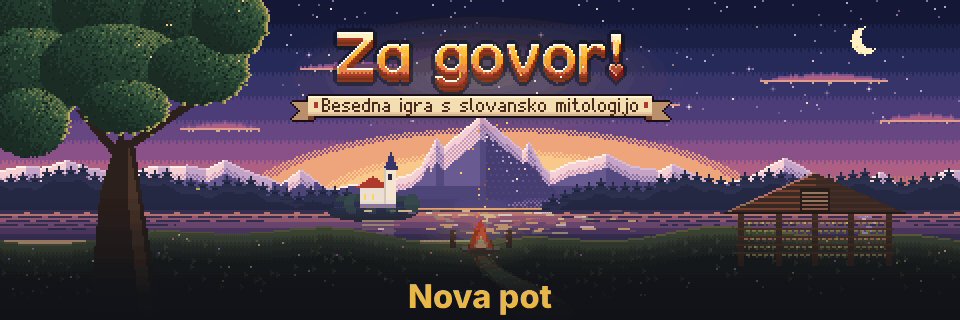
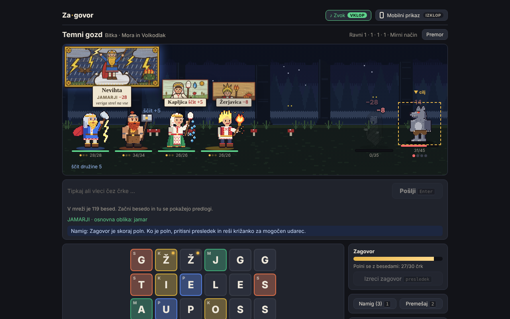
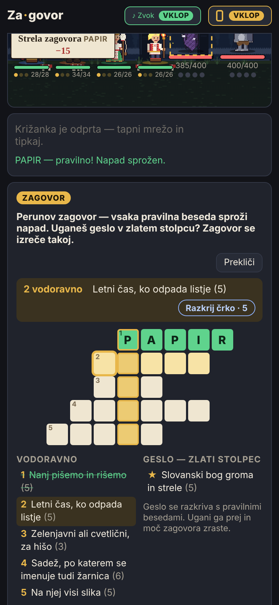
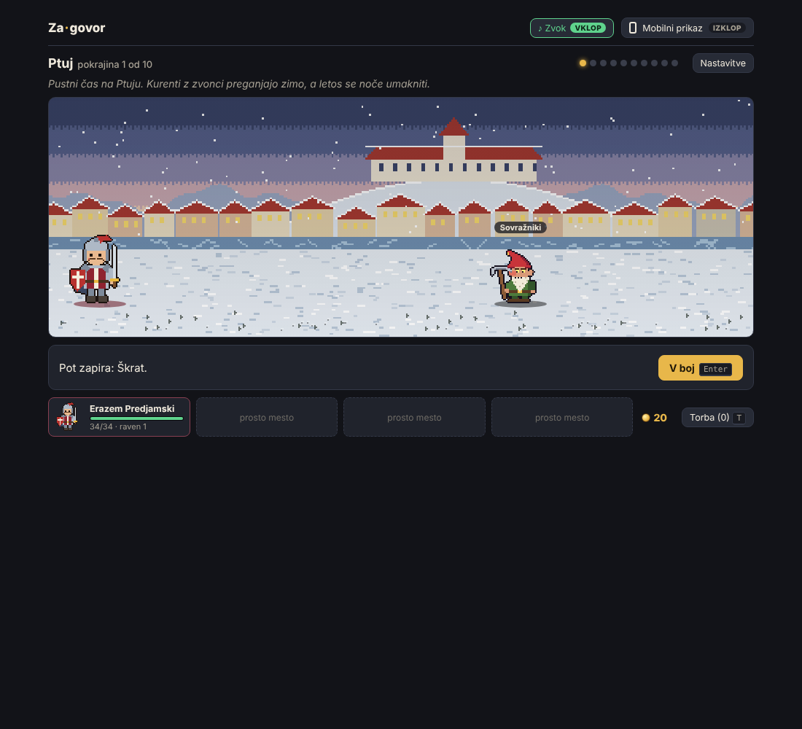

# Za govor!

<p></p>

**A Slovene word-puzzle RPG with heroes from Slavic mythology and Slovene folklore.** Walk
across Slovenia from Ptuj to Ljubljana castle, chain letters into Slovene words to make
your heroes attack, solve crosswords to speak a *zagovor* (a folk charm), and fight the
creatures of Slovene folklore on the way to the dragon. The game is
inspired by [Words for Evil](https://store.steampowered.com/app/335790/Words_for_Evil/)
(Chromosphere Games / Dylan Loney, 2014) and exists to show how rich and playful the
Slovene language is. The game says so itself: on the start screen, after the final battle,
and on its *Zasluge* (credits) screen.

> **Slovensko:** *Za govor!* je besedna igra s prvinami igre vlog v slovenščini. Junaki iz
> slovanske mitologije se bojujejo z besedami: iz mreže črk sestavljaš besede, rešuješ
> križanke in odpiraš skrinje. Igra želi pokazati, kako bogata in igriva je slovenščina.

The name is a play on words: read as one word, *zagovor* is a spoken charm; read as two,
*za govor* means "for speech". The exclamation mark makes it a call: speak up, in Slovene.

**Status:** playable browser prototype of the whole journey and all the mini-games (one page, no install). The
full game is planned in Godot 4.7 for Windows, macOS, Linux, Android and iOS — see
[docs/platform-roadmap.md](docs/platform-roadmap.md).

<p>
  
  
</p>

<p>
  
</p>

## Contents
- [Play the prototype](#play-the-prototype)
- [Phone and Android](#phone-and-android)
- [Missing words](#missing-words)
- [How it plays](#how-it-plays)
- [Controls](#controls)
- [Build from source](#build-from-source)
- [Tests](#tests)
- [Project structure](#project-structure)
- [How the prototype works](#how-the-prototype-works)
- [Language data and sources](#language-data-and-sources)
- [Roadmap](#roadmap)
- [Known issues](#known-issues)
- [Design documents](#design-documents)
- [Licence](#licence)

## Play the prototype
Download or clone the repository and open **`dist/index.html`** in any modern browser
(Chrome, Firefox, Safari, Edge — desktop, phone or tablet). Everything, including the
46,000-word dictionary, the art and the sound, is inside that one file; no server or
internet connection is needed.

The interface is in Slovene. On a phone or tablet the *Mobilni prikaz* layout switches on
by itself; the switch in the top bar changes it at any time.

## How it plays
The game is **one side-scrolling journey** through places in Slovenia. You choose one hero
and walk; the road stops you at enemies, chests, rock slides, wells, pedlars and other
heroes. There is no level list — the road leads from region to region, and the dragon at
Ljubljana castle is the last battle.

| # | Region | Legend of the place | On the road |
| --- | --- | --- | --- |
| 1 | **Ptuj** | Kurent | two battles, a chest |
| 2 | **Peca** | Kralj Matjaž | two battles, a rock slide, a well |
| 3 | **Triglav** | Ajdovska deklica | two battles, a rock slide, a pedlar |
| 4 | **Bled** | a shrine of the old gods: one god may join | two battles, a chest, a well |
| 5 | **Trnovski gozd** | Martin Krpan | two battles, a chest |
| 6 | **Piranske soline** | Lepa Vida | two battles, a pedlar, a well |
| 7 | **Predjamski grad** | Erazem Predjamski | a battle, a rock slide, a chest, an ambush |
| 8 | **Ljubljansko barje** | Zeleni Jurij | two battles, a well, a pedlar |
| 9 | **Ljubljanica** | Peter Klepec | a battle, a well, **Povodni mož** (boss) |
| 10 | **Ljubljanski grad** | — | a pedlar, a well, **Lintvern**, the Ljubljana dragon (final boss) |

- **Walking:** press `→` (or *Naprej*) and the party walks to the next stop; a prompt offers
  what can be done there (`Enter` for the main choice, `Esc` to walk past where that is allowed).
- **The party:** you pick one hero. On a fresh game Martin Krpan, Zeleni Jurij and Kurent
  are known; everyone else is a silhouette until you meet them on the road, which unlocks
  them for later journeys. Up to four travel together; a fifth can only take somebody's
  place. **Only one god** may travel with you — gods hit harder.
- **Health stays as it is after a battle.** **Wells** heal everyone fully and raise the
  fallen. Healers (Mokoš, Zeleni Jurij) heal only up to 70 % of health, and they attack as
  well — weakly at first, stronger with every level.
- **Potions and poisons are used automatically:** a badly hurt hero drinks *Živa voda*, a
  fallen one is raised by *Mrtva voda*, battle potions are opened when a fight begins.
- **Enemies are random:** every battle draws from the enemies of its region, and they grow
  stronger from region to region.
- **Gold and items:** battles and chests pay gold; the pedlar sells potions, poisons and
  relics with names from Slavic myth and Slovene folklore (*Perunova sekira*, *Živa voda*,
  *Velesov strup*, *Zlatorogova roža*…). See [docs/progression-design.md](docs/progression-design.md)
  for the full lists.
- **Intros and pause:** the first time each puzzle appears, a *Kako se igra* panel explains
  it with a solved example and the clock waits until you press *Začni*. `Esc` pauses any
  timed screen; while paused the letters are blurred. *Cel zaslon* in the top bar goes
  fullscreen, and on desktop the game scales so the scene and the puzzle fit the window.
- **Test mode** (a switch on the start screen) starts with 200 gold and lets you skip stops
  and regions.

### Battles: the letter mesh
- A 5×6 grid of Slovene letters (Scrabble letter distribution, balanced vowels). Chain
  neighbouring letters in any of 8 directions into a word and send it (at least 3 letters
  on Malček, 4 on Učenjak and Knjižni molj).
- Used letters disappear and new ones fall in. *Premešaj* reshuffles the grid; *Namig*
  shows the start of a good word (3 per battle on Malček, 1 on Učenjak, none on Knjižni molj).
- Most tiles belong to a hero (coloured, with the hero's initial). **The hero whose tiles
  you use attacks**: one tile = small move, two = medium, three or more = big move with a
  painted card. Several heroes can attack with one word.
- **Longer words hit harder:** 3 letters ×1, 4 ×1.3, 5 ×1.6, 6 ×2, 7 ×2.5, 8 ×3, 9+ ×4.
- **Č, Š and Ž are letters of their own.** They are picked deliberately — typed on a
  Slovene keyboard or tapped — and c, s, z never stand in for them, in the mesh, the
  crosswords, the chest or the rock slide.
- **Every inflected form counts** (*volk, volka, volkom, volkovi…*), but repeating the
  same base word in one battle weakens it: ×1, ×0.6, ×0.35, ×0.2.
- **Č, Š, Ž** in a word give a critical hit (×1.5). Each hero has **domain words** that
  hit ×1.5 (Perun: *grom, strela, nevihta*…; Mokoš: *voda, zemlja, kruh*…).
- Optional **word proposals** (Malček only, for learners) list up to 8 words that continue
  the letters you have started.

### Heroes
All fifteen characters are playable. Nine are folk heroes, six are gods (stronger; one per
journey).

| Hero | Role | Moves (small → big) |
| --- | --- | --- |
| **Martin Krpan** | Heavy single hits; the big move stuns | Zamah → Kobilica → Lipov kij |
| **Zeleni Jurij** | Small heals; unlocks letters; revives once per journey | Popek → Brstenje → Jurjevo |
| **Kurent** | Stuns and delays enemies | Zvonec → Ježevka → Pregon zime |
| **Kresnik** | Fire: damage that keeps burning | Žerjavica → Plamen → Kresni ogenj |
| **Kralj Matjaž** | Shield for the party | Meč → Kraljeva vojska → Prebujenje |
| **Erazem Predjamski** | The next enemy attack misses; shield | Češnje → Skrivni rov → Trdnjava v skali |
| **Peter Klepec** | Grows stronger with every big move | Pastirska palica → Izruvano drevo → Vilin dar |
| **Lepa Vida** | Lowers enemy attack | Hrepenenje → Morska pena → Pesem z obale |
| **Ajdovska deklica** | Turns the target to stone (stun) | Prerokba → Skalni obraz → Okamnitev |
| **Perun** (god) | Highest burst; big move chains lightning to every enemy | Blisk → Grom → Nevihta |
| **Svarog** (god) | Damage plus a shield | Kladivo → Kovani ščit → Nebeška kovačnica |
| **Mokoš** (god) | Heals, cleanses, revives once per battle | Kapljica → Vir → Materina roka |
| **Dažbog** (god) | His light strengthens the next word | Žarek → Jutranja zarja → Sončni voz |
| **Stribog** (god) | Hits every enemy | Sapica → Burja → Vihar |
| **Veles** (god) | Hardest hits, poison | Kačji pik → Medvedja šapa → Korenine sveta |

Each hero has their own health bar and levels up to level 3 (more health, stronger
attacks, extra power for long words). The gallery (*Liki, predmeti in ozadja* on the start
screen) shows every hero with sprites, cards and backstory, the road objects, all items and
the ten backgrounds.

### Enemies
Enemies attack in real time, telegraphed by a glowing wind-up. Their strongest moves
**take the language away**:

| Enemy | HP | Special |
| --- | --- | --- |
| Škrat | 22 | — (bites) |
| Mora | 35 | *Uspavanka*: a hero falls asleep, their tiles go grey |
| Volkodlak | 45 | Grows stronger every time you repeat a word |
| Vodna vila | 30 | *Poplava*: floods letters so they can't be used |
| Povodni mož (boss) | 110 | *Vrtinec*: forces a crossword with the mesh closed |
| Lintvern (boss) | 180 | *Pepel* locks letters; *Ognjeni dih* hits everyone; at half health a forced *Zmajeva uganka* crossword |

Four regional enemies reuse these sprites in other colours for now: **Vešča** (puts a hero
to sleep), **Perkmandeljc** and **Zmajev mladič** (bury letters), **Pesjan** (a heavy hit on
everyone).

### Crosswords and the zagovor
- Every letter you play fills the **zagovor meter** (30 letters). When it's full, a
  **finisher crossword** opens. Each entry turns **green only when it's fully correct** and
  fires the theme hero's attack at once; partial or wrong entries stay **black** and do
  nothing. Solving the whole grid adds a big themed finisher (Perun strikes every enemy,
  Kresnik burns them, Mokoš heals and cleanses, Triglav stuns).
- Crosswords are generated fresh every time from the clue bank of your
  [knowledge level](#two-difficulty-choices): everyday words for Malček (*Ni vse ___, kar
  se sveti* → ZLATO), longer and harder words for Učenjak (*Kuj ___, dokler je vroče* →
  ŽELEZO), and knowledge clues in the style of paper crosswords for Knjižni molj
  (*Avtor Desetega brata* → JURČIČ).
- **Mythology is the reward, not the obstacle.** About half the finishers hide a god's
  name in a **gold column** (*geslo*): PERUN, MOKOŠ, KRESNIK, TRIGLAV… Every correct row
  reveals one letter. Guess the keyword early and the zagovor fires at once, stronger for
  every hidden letter. The other crosswords are mixed, some with one starred mythology
  entry.
- An **ambush crossword** opens some battles (an early combo). Bosses force short crosswords
  of easy words with the mesh closed: solve them for a counterattack, fail and take triple
  damage. The hidden keyword is a way out — URŠKA (from Prešeren's ballad *Povodni mož*)
  frees you from the whirlpool, ZMAJ from the dragon's riddle.
- **Razkrij črko** (or `?`) reveals one letter of the current entry: five per crossword on
  Malček, two on Učenjak, one on Knjižni molj. A word finished with a revealed letter still
  fires, at half power, and revealed keyword letters don't count as guessed.

### On the road
- **Chest:** one word from scrambled letters before time runs out (40 s, 80 s in calm
  mode). The hidden word opens the chest: XP for every hero, gold, one item and a half-full
  zagovor meter in the next battle. A real word that leaves letters unused ends it with
  part of the XP and gold.
- **Rock slide:** every falling rock carries a letter and you have one word. Rocks whose
  letters are in it break (XP and gold for each); the rest graze the party for half damage.
- **Darts (*Puščice v zidu*):** six columns of letters; take one from each column, left to
  right, and send a word. A shorter word may be sent early, and nothing stops you from
  sending a word that does not exist. Every letter of a real word turns one dart against the
  enemies of the next battle; the darts left over hit the party.
- **Well:** every hero is healed and the fallen stand up again.
- **Pedlar:** four potions or poisons and two relics for gold.
- **Shrine:** three gods offer themselves; one may join.
- **Bag:** `T` on the road, `3` in a battle. It only shows what you carry; the heroes use it themselves.

### Two difficulty choices
**Pace** (*Težavnost*): **real-time** (recommended) has no countdown — enemies attack at
their own pace and wear the party down; **calm mode** (*mirni način*) only lets enemies act
after you play words.

**Knowledge** (*Znanje*), chosen below the pace and remembered between visits:

| | Malček (baby) | Učenjak (scholar) | Knjižni molj (book worm) |
| --- | --- | --- | --- |
| Who it's for | Learning words | Learning longer and harder words | Seasoned crossword solvers |
| Shortest word in the mesh | 3 letters | 4 letters | 4 letters |
| Mesh tips | Word proposals, 3 hints per battle, word count, coaching tips | 1 hint per battle, word count, coaching tips | None |
| Finisher crosswords | 359 everyday clues, words up to 7 letters | 219 longer, harder words (school subjects, society, Slovenia, harder proverbs), up to 9 letters | 257 paper-crossword clues (capitals, rivers, Slovene places and writers, art, music, antiquity, science, classic crossword animals) plus the Učenjak words |
| Enemy crosswords | Easiest words, up to 5 letters | Malček words, up to 6 letters | Molj and Učenjak words, up to 6 letters |
| Crossword tips | Letter counts, 5 revealed letters | Letter counts, 2 revealed letters | No letter counts, 1 revealed letter |

Malček is the game as it was before the levels were added.

## Phone and Android
*Mobilni prikaz* (on by itself on touch screens) is the phone version of the game:

- **No Pošlji in the letter mesh.** Lift your finger after a drag, or tap the last letter
  again; a string that is not a word lets go of its letters. A tap on a proposal plays it.
  The chest, the rock slide and darts keep *Pošlji*, because they take one deliberate word.
- **In-game Slovene keyboard** for crosswords and the rock slide: the 25 letters in their
  QWERTZ places with Č, Š, Ž as plain keys. The phone's own keyboard stays closed, so the
  screen never jumps, nothing autocorrects, and every phone behaves the same.
- **Premor** is a labelled button in the top bar; the game also pauses when it goes to the
  background, and the Android back button pauses instead of closing the game.
- Thumb-size targets (40 px and up), secondary text at least 12 px with 4.5:1 contrast,
  safe areas for notches and gesture bars, light haptics on Android.

**Android test app.** Every push to `main` or `android-expansion` builds a debug APK with
GitHub Actions (*Actions → Android test APK → Artifacts → za-govor-debug-apk*). Unzip it,
open the `.apk` on the phone and allow installing from that source; later builds install
over it. The app is the same `dist/index.html` wrapped with Capacitor 8 (portrait, target
SDK 36). To build it yourself you need Node 22+, JDK 21 and Android Studio:

```sh
npm install
npm run android:apk     # -> android/app/build/outputs/apk/debug/app-debug.apk
npm run android:open    # or open the project in Android Studio
```

## Missing words
The word list is still the prototype's (see [Language data and sources](#language-data-and-sources)),
so players will meet real Slovene words it does not know. The game helps catch them:

- **Every word it turns down is remembered** on the device (the last 40): in the letter
  mesh, the chest, the rock slide and darts. The first rejection of a visit says where to
  report it.
- **Prijavi besedo** in the pause window (`Esc` / *Premor*) and **Prijavi manjkajočo
  besedo** on the start screen list those words; one tap reports a word, with an optional
  note (meaning, dialect). A word can also be typed. Words the game already knows are not sent.
- **Reports go to a Google Form**, whose answers land in a spreadsheet, with an e-mail per
  answer. They carry only the word, where it was turned down, the note, and the level,
  pace and device type: no names or e-mail addresses. Until the form is set up, or while
  offline, reports wait on the device and the list can be copied.

**Connect the form:** create a form with four short-answer questions, *Beseda*, *Kje*,
*Opomba* and *Podatki* (none required, no sign-in, no e-mail collection), link it to a
Sheet, then take *⋮ → Get pre-filled link*. Its ID (`/forms/d/e/<ID>/viewform`) and the four
`entry.<number>` values go into `REPORT_FORM` at the top of `src/report.js`.

**Process the reports:** download the Sheet as CSV and run

```sh
python3 tools/check_reports.py responses.csv [--lexicon forms.txt ...]
```

It counts reports per word and marks each as already accepted (with its base form), found
in an extra word list given with `--lexicon`, or missing, with a Fran.si link. Since the game
accepts all of Sloleks, Franček and the thesaurus, most reports will be words those lack.
Confirmed words go into `data/allow.json` (lemma → forms); then rebuild the word list
(see [Build from source](#build-from-source)) and run `python3 build.py`.

## Controls
| Action | Keyboard | Mouse / touch |
| --- | --- | --- |
| Make a word | Type it; the path is found for you. Č, Š, Ž must be typed as themselves (a Slovene keyboard layout), c/s/z never stand in for them | Drag across tiles, or tap them one by one |
| Send the word | `Enter` | Lift the finger after a drag, or tap the last letter again (*Pošlji* on desktop, and in chest, rock slide and darts) |
| Clear the word | `Delete` | *Počisti* |
| Pause (battle, crosswords, chest, rock slide, darts) | `Esc` | *Premor* in the top bar |
| Remove the last letter | `Backspace` | *Briši* |
| Speak the zagovor (meter full) | `Space` | *Izreci zagovor* |
| Hint / reshuffle / look into the bag | `1` / `2` / `3` | *Namig* / *Premešaj* / *Torba* |
| Walk on the road, confirm a stop | `→` or `Enter` (`Esc` = walk past, `T` = bag) | *Naprej* and the buttons of the stop |
| Crossword: reveal a letter | `?` | *Razkrij črko* |
| Crossword: next entry, move | `Enter` or `Tab`, arrow keys | Tap a cell or a clue; type on the in-game keyboard, *Naprej* for the next word |
| Android back button | — | Pauses a puzzle, closes a panel, steps back to the start screen; leaves the app only from there |

## Build from source
`dist/index.html` is built from the files in `src/` and `data/` by a small Python script
(standard library only):

```sh
python3 build.py            # -> dist/index.html
```

The generated data files are committed, so this is all you need. To regenerate them:

```sh
python3 tools/build_lexicon.py ~/Downloads/SlovenianResource   # word list -> data/lexicon.bin (~1.5 min the first time)
python3 tools/xref_sources.py ~/Downloads/SlovenianResource    # what each dictionary has that the game does not accept
python3 tools/cluebank.py     # crossword clues   -> data/clues.json (validates every clue on every level)
python3 tools/art_title.py    # title scene       -> src/art-title.js (--preview writes test-output/title-scene.png)
python3 build.py
```

The word list needs these zips from the CLARIN.SI repository in one folder, kept zipped
(standard library only, no `pip install`). The first run unpacks every Sloleks form into
`build/sloleks_forms.tsv.gz` (ignored by git) and later runs reuse it.

| Zip | Used for | Licence |
| --- | --- | --- |
| [`Sloleks.3.1.zip`](http://hdl.handle.net/11356/2080) (263 MB) | every word form, base forms, Gigafida frequency | CC BY-SA 4.0 |
| [`FrancekPortalHeadwordList.zip`](http://hdl.handle.net/11356/1445) | headwords Sloleks lacks; which words the game suggests | CC BY 4.0 |
| [`CJVT-Thesaurus-of-Modern-Slovene-v2.2.zip`](http://hdl.handle.net/11356/2092) | headwords both lack | CC BY-SA 4.0 |
| [`eSSKJSchoolEdition.zip`](http://hdl.handle.net/11356/1456), [`SchoolDictionaryOfSlovenianLanguage-semantic.zip`](http://hdl.handle.net/11356/1451) | only checked by `tools/xref_sources.py` | CC BY 4.0 |

To add or change crossword clues, edit the banks in `tools/cluebank.py` — `MALCEK`,
`UCENJAK` and `MOLJ`, one line per clue (`ANSWER|clue|topic|difficulty`) — and `THEMES`
for the mythology keywords. The script checks the alphabet, length, duplicates, that no
clue gives its answer away, and that on every level every keyword letter has enough words
to build a keyword column. The level settings themselves live in `LEVELS` in
`src/game.js`; `tools/cluebank.py` mirrors the crossword part to validate against it.

## Tests
The tests open the built page in headless Chrome and play it through a test hook
(`window.__ZG`). They need Node 18+ and a local Chrome or Chromium.

```sh
npm install
python3 build.py
npm test                                  # all ten test files
CHROME_PATH=/path/to/chrome npm test      # if Chrome isn't found automatically
```

| File | What it checks |
| --- | --- |
| `tests/crossword-generator.test.js` | 4,200 generated crosswords on all three levels: no letter clashes or stray letters, connected grids, everything fits 9×9, only that level's clue banks, short words in enemy crosswords, the gold column spells the keyword |
| `tests/levels.test.js` | Each knowledge level: chosen and saved on the title screen, hints and proposals, word count and coaching tips, shortest word, crossword bank, letter counts, revealed letters (and half power), mouse clicks reaching the crossword |
| `tests/keyword.test.js` | Guessing the keyword early ends the crossword and fires the zagovor; in Povodni mož's whirlpool *urska* with a plain s stays black and *urška* breaks it |
| `tests/phone.test.js` | On a 390×844 touch screen: the mesh sends without *Pošlji* (second tap, lifted drag, non-words clear), the in-game keyboard types crosswords and the rock slide with the system keyboard closed, wrong entries stay black and correct ones fire, chest partial rewards, darts fit 360 px, *Premor*, and the Android back button |
| `tests/credits.test.js` | Words for Evil is credited on the start screen, the *Zasluge* screen (with every source and a Steam link) and the ending; the line fits a 360 px phone; Esc and the Android back button leave the credits |
| `tests/report.test.js` | *Prijavi besedo*: rejected words are remembered (mesh, chest), the pause screen and start screen list them, one tap posts word, place, note and level to the Google Form (intercepted), typing works while paused, known words are not sent, the queue waits without a form and goes out once there is one, lists survive a reload, the panel fits a 360 px phone; *jasa* and base forms are accepted |
| `tests/journey.test.js` | The road: choosing the first hero, walking to a stop, one enemy for one hero, no healing after a battle, a hero joining, the chest's gold and item, the well, the pedlar, using a potion, the bag pausing the battle, the shrine and the one-god rule, swapping with a full party, all 45 hero moves, the dragon and the ending |
| `tests/lexicon.test.js` | The word list in the browser: over a million forms accepted and a common part suggested, the 217-word coverage set accepted and its non-words (Croatian, English, made up) refused, the reported words (*jasa*, *loj*, *runa*, *seks*) and *ritem*/*ritual*/*riti*, vulgar words accepted but never suggested, mythology names, *deny.json*, non-standard forms, base forms (*ljudje* → *človek*), headwords Sloleks lacks (*zborišča*, *sedemkotnik*), and at 4× slower CPU a mesh walk under 50 ms and a lookup under 20 µs |
| `tests/title.test.js` | The title scene: the *Za govor!* heading and tab title, whole-number scaling (3× at 1280 px, 4× at 1920, 2× on a phone), square wordmark pixels, full width with no sideways scrolling (also at an odd width), right under the top bar, room left for the menu, the wordmark standing still, sparks rising in whole art pixels and not restarting when the start screen is rebuilt, a still picture with reduced motion |
| `tests/desktop.test.js` | A keyboard playthrough: c/s/z are not accepted for č/š/ž, first battle, result and hero screens, chest, finisher, Lintvern's letter lock and forced crossword, ambush, rock slide, and no console errors anywhere |

Screenshots from each run land in `test-output/` (ignored by git).
`npm run screenshots` regenerates the images in `docs/images/` used by this README.

## Project structure
```
za-govor/
├── build.py                  # inlines src/ + data/ into dist/index.html
├── dist/index.html           # the playable prototype (built, committed)
├── src/
│   ├── index.src.html        # page template with placeholders
│   ├── game.js               # battles, crosswords, chest, rock slide, heroes (no framework)
│   ├── journey.js            # the road: regions, stops, party, items, pedlar, bag, darts
│   ├── playtest.js           # pause, puzzle intros, fullscreen, fit to screen
│   ├── mobile.js             # phone specifics: in-game keyboard, haptics, Android back button
│   ├── credits.js            # Zasluge: the Words for Evil credit and every source
│   ├── report.js             # Prijavi besedo: rejected words, reports to a Google Form
│   ├── art-extra.js          # generated pixel art (tools/art_extra.py)
│   ├── art-title.js          # generated title art: scene layers, wordmark, ribbon (tools/art_title.py)
│   ├── title.js              # the title scene: whole-pixel scaling, sparks, fireflies, layout
│   ├── title.css             # the title scene's layers and motion
│   └── game.css              # styles, desktop and phone layouts
├── android/                  # Capacitor 8 Android project (npm run android:open)
├── capacitor.config.json     # app id, name, webDir: dist
├── .github/workflows/        # android-apk.yml: debug APK on every push
├── data/
│   ├── lexicon.bin           # word list: 1.48 million forms, each with its base form, packed (tools/lexicon.py)
│   ├── allow.json            # reported words checked by hand, merged into the word list
│   ├── deny.json             # foreign words the sources contain (Croatian, English citation forms)
│   ├── never-suggest.json    # vulgar words and slurs: accepted, never offered
│   ├── myth.json             # mythology and enemy names with their forms, always suggested
│   ├── clues.json            # crossword clue banks per knowledge level, mythology keywords
│   └── world.json            # the journey: regions, stops, enemy pools, items
├── tools/
│   ├── build_lexicon.py      # builds data/lexicon.bin from Sloleks, Franček and the thesaurus
│   ├── sloleks_extract.py    # every form from the Sloleks XML (reads the zip directly)
│   ├── inflect.py            # inflects headwords Sloleks lacks by analogy with Sloleks words
│   ├── lexicon.py            # the packed word list: writer and reader (format description)
│   ├── xref_sources.py       # cross-reference: what each dictionary has that the game does not accept
│   ├── check_reports.py      # checks the words players reported (CSV from the form's Sheet)
│   ├── cluebank.py           # the three clue banks; validates and builds data/clues.json
│   ├── art_extra.py          # draws the new heroes, road objects, item icons and backgrounds (needs Pillow)
│   ├── art_title.py          # draws the title scene, the Za govor! wordmark and its ribbon (needs Pillow)
│   └── readme-shots.js       # regenerates docs/images/
├── tests/                    # headless Chrome tests (puppeteer-core)
└── docs/
    ├── concept-summary.md    # decisions, art and audio direction, sources
    ├── progression-design.md # the journey, party rules, roster, enemies, items
    ├── platform-roadmap.md   # plan for desktop, phone and tablet releases
    └── images/               # README screenshots
```

## How the prototype works
- **One file, no dependencies.** Plain JavaScript with a tiny `h()` element helper; no
  framework or bundler. `build.py` inlines the CSS, the data files (the word list as base64)
  and the scripts into one HTML page.
- **The journey.** `data/world.json` lists the regions in travel order with their stops,
  enemy pools and local hero, and all items. On the travel screen the party stands still
  and the stops slide towards it; the background pans slowly across the region's landmark.
  The same file is meant to feed the Godot game.
- **Dictionary.** `data/lexicon.bin` is a minimised automaton (DAWG) over every accepted
  form, 1.48 million of them in 1.4 MB. Each form ends in a mark saying whether the game may
  *suggest* it or only *accepts* it, followed by its base form written as "drop n letters,
  add these" (*ljudje* → drop 6, add *človek*). `src/lexicon.js` keeps it as one
  `Uint32Array` of edges and walks it in place: no set of strings, no object trie, about
  35 ms to load on a laptop. Finding every word in the mesh is a depth-first search over the 8-neighbour
  grid that only follows letters that can still lead to a suggested word; the same search
  powers hints, proposals and the "words in the mesh" count. A word the player makes counts
  if it is accepted, so rare and inflected words score too, but the game never proposes them.
  Typed input finds a matching path automatically; letters must match exactly, so c, s and
  z never match a č, š or ž tile.
- **Mesh refill.** Letters are drawn from the Slovene Scrabble distribution (98 tiles),
  vowels are balanced, and the grid is re-rolled if it holds too few words.
- **Crossword generator.** Two styles. *Keyword column:* for each letter of the keyword,
  pick an everyday word containing it and shift the row so that letter lands in the gold
  column. *Mixed crossword:* place a first word, then repeatedly add the bank word with the
  most crossings, rejecting any placement that would touch other letters side by side,
  overlap in the same direction or leave the 9×9 box; keep the best of up to 24 attempts
  and number entries in reading order. Each puzzle takes about 10 ms.
- **Phone keyboard input.** On phones crosswords and the rock slide are typed on an
  in-game keyboard (`src/mobile.js`); the hidden crossword `<input>` gets
  `inputmode="none"` so the system keyboard stays closed. A hardware keyboard still types.
  On desktop the hidden field keeps a zero-width sentinel and diffs each `input` event
  against the previous value, which copes with autocorrect, swipe typing, IME composition
  and Backspace.
- **Art.** Pixel sprites (48×48, bosses 64×64, two frames each) and backgrounds are PNG
  sheets embedded as data URIs; the painted folk-art cards are SVG built in JavaScript,
  one painting per hero per attack size. Cards appear above the attacker inside the scene,
  never as pop-ups, and never block input.
- **Sound.** 16 retro effects synthesised in the browser with ZzFX; no audio files.
- **Test hook.** `window.__ZG` exposes the game state and a few functions (`go`,
  `allWords`, `findPath`, `makeCrossword`, `openCrossword`…) so the tests can drive the
  game.

## Language data and sources
- **Words** (`data/lexicon.bin`, built by `tools/build_lexicon.py`): lowercase words of
  3–15 letters of the Slovene alphabet, no names.
  - *Accepted:* every form of every common word in
    [Sloleks 3.1](http://hdl.handle.net/11356/2080) (CJVT, University of Ljubljana; CC BY-SA
    4.0), 1.23 million forms. On top of that the headwords Sloleks lacks, from the
    [Franček headword list](http://hdl.handle.net/11356/1445) (ZRC SAZU; CC BY 4.0; 23,958
    words such as *zborišče*, *kombajnar*, *kolarna*) and the
    [Thesaurus of Modern Slovene 2.2](http://hdl.handle.net/11356/2092) (CJVT; CC BY-SA 4.0;
    3,922 words such as *sedemkotnik*, *oceanologija*), 250,000 forms in all. Their forms are
    borrowed from hand-checked Sloleks words of the same class that end the same way
    (`tools/inflect.py`): *zborišče* inflects like *igrišče*. Tested on Sloleks words held
    out of their own vote, 98.5 % of the guessed forms are right; where the analogues
    disagree (*biter*, *konop*) the word keeps only its base form. Plus the mythology names
    (`data/myth.json`) and reviewed reports (`data/allow.json`), minus foreign words
    (`data/deny.json`: Croatian and English text Sloleks picked up from the corpus, and
    English or French citation forms in the dictionaries, such as *house* or *jeep*).
  - *Suggested* (proposals, hints, word counts, darts and rock-slide words): 186,510 forms
    of words that are hand-checked in Sloleks or listed in Franček, common in the Gigafida
    2.0 corpus (frequency ≥ 1,000), standard, and not in `data/never-suggest.json` (vulgar
    words and slurs, matched exactly, so *ritem* and *riti* are not caught by *rit*).
  - *Cross-reference* (`tools/xref_sources.py`, 12 Nov 2026): of the one-word entries of each
    dictionary the game accepts 99.9 % of Franček (the rest are the citation forms in
    `deny.json`), 99.7 % of the eSSKJ school edition, 100 % of the school dictionary and
    99.9 % of the thesaurus. Before, the list from simplemma and wordfreq accepted 104 of the
    217 words of a hand-picked set of valid words; now it accepts all of them.
- **Crossword clues:** all 835 clues (359 Malček, 219 Učenjak, 257 Knjižni molj) were
  written for this project. There is no Slovene crossword API; magazine crosswords
  (*Razvedrilo*, *KIH*, *3K*) are copyrighted, and solver sites such as Pet vodoravno are
  communities, not data sources, so the Knjižni molj clues are written *in the style of*
  paper crosswords, not taken from them. Malček and Učenjak follow the friendly modern
  Slovene style — everyday words, verbs, adjectives, proverb fill-ins — instead of obscure
  crossword filler. To scale up later, CJVT's open synonym
  and collocation dictionaries can suggest clue candidates for a person to edit; a
  professional setter (for example Križankar) could edit the final bank.
- **Mythology:** Slovene folklore first (Monika Kropej's work), then pan-Slavic deities and
  public-domain literature (Prešeren's *Povodni mož*, Levstik's *Martin Krpan*). The
  hero backstories in the prototype are first drafts and need a folklore check.
- **Sound:** [ZzFX](https://github.com/KilledByAPixel/ZzFX) (MIT).
- **Art:** prototype pixel art and card paintings made for this project to set the
  direction; final art is meant for illustrators.

## Roadmap
1. **Playtest the prototype** — the one gate that can kill the project is whether the
   Slovene grid is fun. Testers on Android install the debug APK from GitHub Actions;
   others open `dist/index.html` or a hosted copy.
2. **Move the rules into shared data files** that the prototype and the Godot game both read.
3. **Build the Godot 4.7 game** (GDScript, Compatibility renderer, 640×360 pixel base) with
   one adaptive layout: portrait on phones, landscape on tablets and desktop.
4. **Input for keyboard, touch and controller**, including Steam Deck's on-screen keyboard.
5. **Release:** Steam (Windows, macOS, Linux, Steam Deck) with a free web demo first, then
   Android, then iOS.

Game design still to build: a party of three starters (Martin Krpan, Zeleni Jurij,
Kurent), meeting heroes on the road, cursed gods as bosses whose true name breaks the
curse, items, and the full campaign *Kolo leta* — four acts, one turn of the year. Details
in [docs/progression-design.md](docs/progression-design.md) and
[docs/platform-roadmap.md](docs/platform-roadmap.md).

## Known issues
- The sound effects were tuned without listening and need adjusting by ear.
- Battles still use the four gods as the party; the planned party of three starters is not
  built yet.

## Design documents
- [Concept summary](docs/concept-summary.md) — confirmed decisions, art and audio
  direction, crossword sources, open questions.
- [Progression design](docs/progression-design.md) — party, health and levels, roster,
  cursed-god bosses, items, backgrounds.
- [Platform roadmap](docs/platform-roadmap.md) — from browser prototype to Windows, macOS,
  Linux, Android and iOS.
- [Playtest notes](docs/playtest-notes.md) — what each test round found and what changed

## Licence
Za govor is an original game inspired by Words for Evil; it reuses none of its code, art,
text or sound and is not officially connected to its authors. The in-game *Zasluge* screen
credits the inspiration and every third-party source.

No licence has been chosen yet, so all rights are reserved by the author. Third-party
data and code keep their own licences (see [Language data and sources](#language-data-and-sources)).
The word list (`data/lexicon.bin`) is adapted from Sloleks and the thesaurus, both CC BY-SA
4.0, so it is shared under CC BY-SA 4.0 too, whatever licence the rest of the game gets; the
*Zasluge* screen credits every source.
