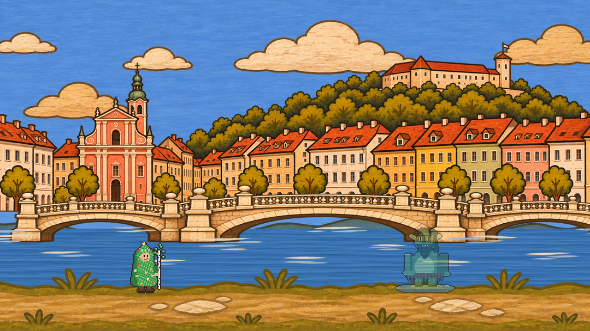

# Ljubljanica parallax study

This folder turns the approved side-view Ljubljanica illustration into a motion study for travelling right along the river. The bridge and castle become the destination; the final frame settles on the existing battle reference with Povodni mož. The art layers and preview are references for a later game implementation, not production runtime assets.

Open [the interactive journey preview](preview.html) in a browser. Scrub the Journey slider or play the 14-second approach. At the end, it resolves to the exact approved [Ljubljanica battle reference](../slovenia-folk-location-previews/ljubljanica-folk-preview.png). The preview uses Zeleni Jurij as a visual stand-in because Peter Klepec is not currently present in the sprite sheet.

This frame shows the layered scene near arrival, before it resolves to the final battle composition:

## Layer stack

The layer files are deliberately separate PNGs. Scenic cutouts preserve transparency; pixel characters remain crisp. Read the stack from farthest away to closest to the viewer:

| Order | Image | Purpose | Motion starting point |
| --- | --- | --- | ---: |
| 1 | [distant-sky-hills.png](layers/distant-sky-hills.png) | Sky and far hills; the base plate | 0.10× |
| 2 | [clouds.png](layers/clouds.png) | Independent cloud band with slow ambient drift | 0.035× |
| 3 | [town-castle.png](layers/town-castle.png) | Old-town roofs, church, castle hill and treeline | 0.22× |
| 4 | [river-surface.png](layers/river-surface.png) | River texture, extended beyond the view edges | 0.50× |
| 5 | [bridge.png](layers/bridge.png) | Isolated, side-on Triple Bridge with visible arches | 0.40× |
| 6 | [water-reflections.png](layers/water-reflections.png) | Separate muted highlights over the river, behind the bridge | 0.58× |
| 7 | [foreground-road.png](layers/foreground-road.png) | Near bank/path band; fastest scenery layer | 0.90× |
| 8 | [hero-zeleni-jurij.png](layers/hero-zeleni-jurij.png) and [enemy-povodni-moz.png](layers/enemy-povodni-moz.png) | Existing pixel-art character frames | Screen-anchored in this study |

The `×` values are fractions of the camera's total horizontal travel. They are initial art-direction values, not measured production tuning. As the camera travels right, scenery moves left: distant land shifts least, the bridge and water move more, and the foreground path moves fastest. Keep the clouds' extra drift slower than the camera motion. The preview scales travel distance with the scene width, so the ratios remain usable at different display sizes.

[`riverfront-clean-plate.png`](layers/riverfront-clean-plate.png) is a cleanup/reference plate used while separating elements. It is not stacked in the preview. Keep alpha on the clouds, bridge, reflections, town and path layers so they can be repositioned without rectangular edges.

## Journey and ambient motion

- Begin with the bridge farther to the right and the hero grounded on the near bank. The town and castle stay visible as landmarks while the river path advances.
- Move the scene layers left at their relative camera speeds above. The path should read as the nearest and quickest-moving band.
- Let Povodni mož enter only in the approach's final section. Stop the camera when the battle area is framed; do not keep the arena sliding during combat.
- Use a restrained, slow cloud drift and a low-contrast water glint/reflection loop. Avoid fast ripples, flashing, or high-amplitude bobbing that would compete with pixel characters.
- The preview's last four percent crossfades to the exact approved battle reference. A production scene should instead land on its assembled layers and character placements; use the crossfade here only to make the intended destination unambiguous.
- Honor `prefers-reduced-motion`: disable ambient loops and provide a direct, non-animated arrival. Keep the slider available for deliberate inspection.

## Mobile and production handoff

- Build a camera viewport that follows the same rightward route. Use transform-based offsets and normalized camera distance; avoid layout-driven animation so the layer stack stays smooth on mobile.
- Author wide landscape framing first so the side-on bridge arches remain readable. For portrait, pan/reframe along the route or create a portrait composition; do not crop away the bridge arches or Povodni's battle space with a blind center crop.
- Keep the party, enemy and any battle UI inside a tested safe area. Recheck character scale and collision/ground positions on small screens, with the path beneath their feet.
- Keep pixel-art characters on integer scales where possible and retain crisp nearest-neighbor rendering. Use the painted layers as broad, calm shapes behind them.
- Tile or extend the river and near-bank path beyond both camera limits. Check that no transparent gaps appear at the start, midpoint, or final camera position.
- Optimize production exports for the mobile asset budget after the layer geometry is approved. The PNGs here retain working resolution and alpha for review; these generated cutouts may need edge cleanup and further separation of the castle hill, town, and treeline before release.

## What this is (and is not)

This is a local, interactive art-direction preview plus transparent layer references. It does not modify game code, add a runtime parallax system, alter the approved folk illustration, or finalize camera coordinates. Use it to review the speed hierarchy, the side-view bridge, the water/cloud separation, and how the painterly landscape sits behind the existing pixel-art style.
