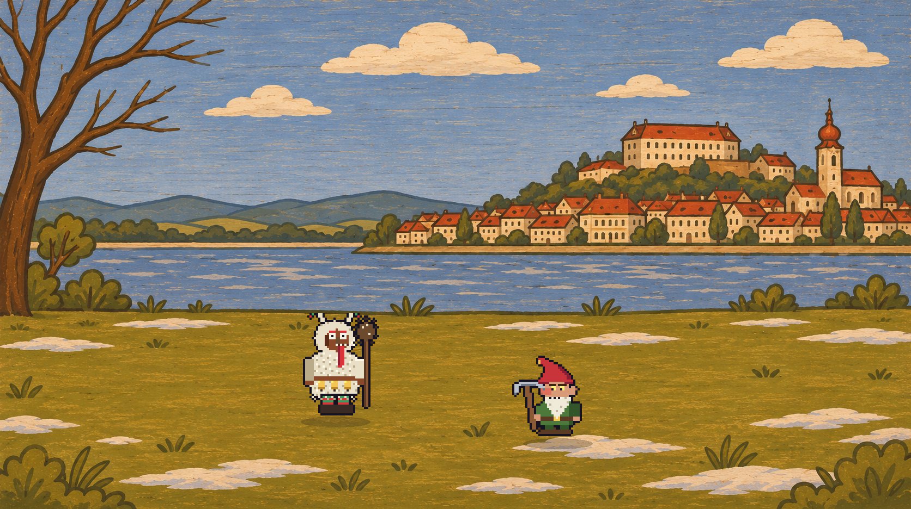

# Ptuj folk-art background and sprite contrast preview

This is a local art-direction experiment, not a production background pack. It pairs a painted Ptuj panorama with the existing pixel-art Kurent hero and Škrat enemy to test the contrast between the two media.

## Style notes: the current folk-card treatment

The recent skill-card illustrations use a compact, hand-painted folk-board language informed by Slovenian folk painting and panjske končnice. The reference is the character skill-card art, not a literal attempt to reproduce a historical object.

- Build each subject from a small number of broad, legible shapes. Keep the main action and silhouette readable at card size.
- Use warm ochre, cream, russet, moss green, and river blue, balanced with deep brown-black contour lines.
- Let outlines stay confident and slightly irregular, like hand-inked paint on a board.
- Use mostly flat fills with a few larger internal marks for material, expression, and motion. Keep surface grain subtle and secondary.
- Favor simple, staged compositions with a clear foreground, middle distance, and background. Leave breathing room around the action.
- Preserve each character's established folk costume and story cues. The style simplifies the rendering; it does not redesign the character.
- Keep the card frame and presentation separate from the illustration. This environment preview has no frame, title, game UI, or lettering.

## Applying the look to Ptuj

Treat the location as a broad, calm painted panorama: Drava water and restrained reflections, the compact historic roofline and castle on its low hill, distant Podravje hills, and a quiet strip of foreground ground. Separate the scene into broad color planes and silhouettes. Use the established blue, ochre, russet, cream, and green palette, with dark outlines and restrained board-like texture.

The hero group should sit left of the panorama's center while the landscape remains visible on both sides. Keep the near ground simple and low contrast so silhouettes, combat effects, and eventual battle UI have room. Do not add a bridge or fantasy landmarks. Foreground plants should be separate from the combatants and, in a runtime scene, must not cover above ankle height.

## Sprite and background contrast

The scene deliberately keeps the existing game sprites as native pixel art: they are not repainted, outlined again, blurred, or given a painterly texture. The preview enlarges one idle frame with crisp pixel edges over a softly textured painted scene. Their dark sprite outlines and small, clean color clusters provide separation; restrained ground shadows help them sit on the terrain. The intended contrast is an explicit mixed-media choice, not an attempt to make the environment look like pixel art or the sprites look painted.

## Preview contents and limits

- `ptuj-folk-background.png` is a generated scenic concept, without characters or UI.
- `ptuj-folk-style-preview.png` is the rendered composite, with the idle frames from the current game sprite sheet (`Kurent` hero and `Škrat` enemy) placed over the scene. The SVG alongside it is an editable composition source with the image data embedded.
- The generated skyline is an art-direction sketch, not a verified geographic reconstruction. The composite uses one flattened background and does not provide parallax, transparent layers, loopable water, or runtime layout coordinates.
- This experiment does not update the open production asset manifest at `../ptuj-background/ASSET_MANIFEST.md` or the battle-depth specification at `../ptuj-battle-depth/README.md`.
## Next: parallax and mobile

Treat this composite as a visual reference. For production, paint or derive separate sky, distant hills, town and castle, river and reflections, and foreground planes so their motion can be tuned independently. Then test calm ambient effects and mobile landscape and portrait crops in the actual battle viewport. Keep battle UI readable and pixel sprites crisp at mobile sizes. The reference image itself is flattened and does not implement these effects.