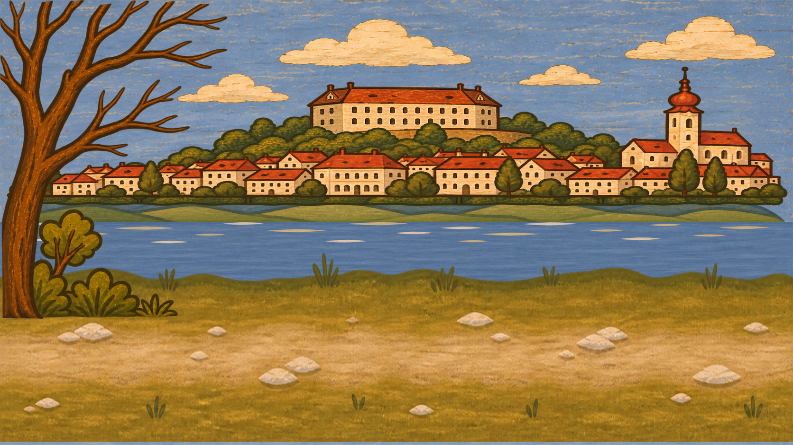

# Ptuj folk-art parallax slices

This is the first layer pack made from the already-reviewed Ptuj folk-art background. The original reference remains at [`ptuj-folk-background.png`](../ptuj-folk-style-preview/ptuj-folk-background.png); the existing Kurent and Škrat contrast preview is unchanged. These slices are available as opt-in runtime variant B; variant A remains the default pixel-art background.

Open [the interactive slice preview](preview.html), scrub the journey slider, or play the 12-second pan. A static assembled frame is also available:

## Slice stack

The layer order runs from far to near. Scenic cutouts have transparent backgrounds; the sky and water surfaces are filled layers.

| Order | Image | Use | Starting camera ratio |
| --- | --- | --- | ---: |
| 1 | [sky.png](layers/sky.png) | Painted sky texture/base | 0.08× |
| 2 | [clouds.png](layers/clouds.png) | Separate slow-drifting cloud band | 0.025× + ambient drift |
| 3 | [distant-hills.png](layers/distant-hills.png) | Blue-green Podravje ridge silhouettes | 0.17× |
| 4 | [castle-hill.png](layers/castle-hill.png) | Ptuj Castle and wooded hill | 0.25× |
| 5 | [town.png](layers/town.png) | Old-town roofs, church and trees | 0.33× |
| 6 | [drava-water.png](layers/drava-water.png) | Calm river fill, separate from reflections | 0.55× |
| 7 | [water-reflections.png](layers/water-reflections.png) | Sparse independent water marks | 0.58× + subtle glint |
| 8 | [foreground-oak.png](layers/foreground-oak.png) | Left-edge near-foreground tree and shrubs | 0.82× |
| 9 | [foreground-road.png](layers/foreground-road.png) | Near-bank path/ground strip, fastest layer | 1.0× |

The ratios are first-pass fractions of horizontal camera travel. Moving the camera right moves scenery left: far scenery moves least, the town and water move farther, and the near-bank road moves fastest. Keep cloud drift and water glint restrained. Use transforms rather than layout animation in the game renderer; tune the values after checking actual battle staging and mobile crops.

## Review notes and production handoff

- The source panorama is the style and composition reference. Cutouts are separate generated transparent images, then positioned independently in the preview.
- The generated layers keep the same broad landmarks and folk-painted palette, but are not pixel-exact extractions. Inspect edge halos and overlaps before treating them as final source art.
- Keep the battle floor clear and foreground plants below ankle height. Preserve the existing crisp pixel-art characters over the painted background.
- Check camera start, midpoint and end for exposed edges. The water and path need enough overdraw or tiling for the complete camera travel.
- The preview follows the same layer ratios and composition, but it is not a game runtime effect. Production dimensions, export formats, mobile safe areas, and battle coordinates still need implementation review.

## Next steps

1. Use these slices as the Ptuj baseline; refine any alignment or edge issues found during integration.
2. Review the existing Peca folk-art character preview before any Peca slicing begins.
3. For each later region, make and show its character/background preview first; only create its slices after that scene is approved.
4. Once the region art is sliced, tune parallax, ambient loops, reduced-motion behavior, and mobile landscape/portrait framing in the actual battle viewport.
