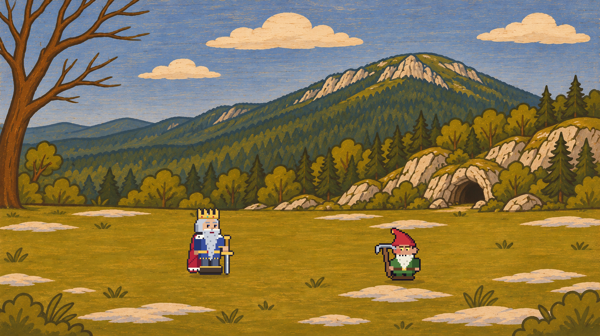
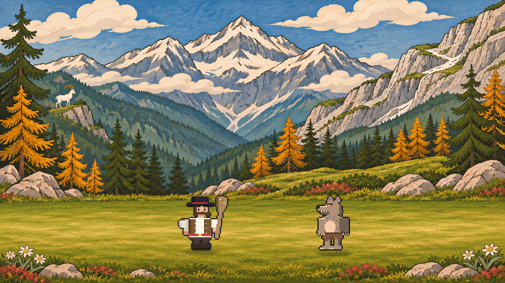
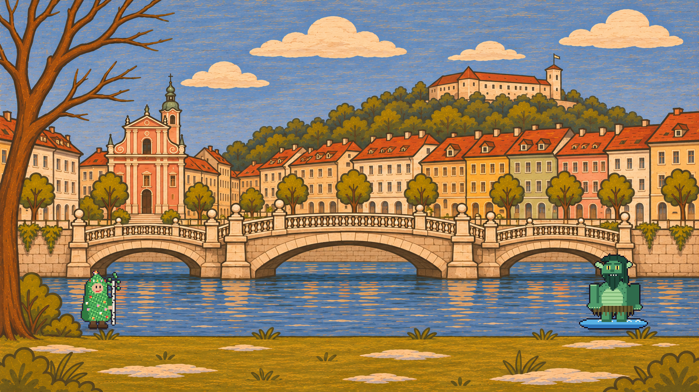

# Slovenian folk-style location previews

Four local art-direction concepts extend the treatment documented in [the Ptuj folk-card and background guide](../ptuj-folk-style-preview/README.md). Each panorama is shown by itself and with actual idle-frame game sprites composited over it. These are previews only: no production art manifest, runtime scene, or character sprite has been changed.

## Peca

[Background only](peca-folk-background.png) · The campaign notes place Kralj Matjaž at Peca and list Škrat among the region's enemies. The art suggests the forested Karavanke and his cave beneath the mountain. [I feel Slovenia describes the sleeping-King Matjaž legend at Peca.](https://www.slovenia.info/en/press-centre/news-of-the-tourism-press-agency/6837-sleeping-king-and-peca-underground)

## Triglav

[Background only](triglav-folk-background.png) · The three snowy peaks and a small golden-horned ibex evoke the chapter's legends. The cliff wall has natural rock contours without a human portrait. A broad grassy lane runs horizontally across the foreground for left-to-right travel. Krpan is a party-sprite stand-in for composition; the regional Pesjan uses its current Volkodlak-based gameplay sprite. Ajdovska deklica's gameplay pixel sprite is not in the current sprite bundle. The separate [Triglav parallax study](../triglav-parallax/README.md) includes the first slices and a camera preview.

## Trnovski gozd

[Background only](trnovski-gozd-folk-background.png) · A moonlit karst-forest path frames the campaign's Martin Krpan and its Volkodlak enemy. The landscape cue is the forested high karst plateau and doline of Trnovski gozd; see the [Natura 2000 Slovenia reference](https://natura2000.gov.si/fileadmin/user_upload/Dokumenti/natura2000inslovenia.pdf).

## Ljubljanica

[Background only, side-view version](ljubljanica-folk-background.png) · The river, historic embankment, side-on Triple Bridge and castle hill set up a scene with the existing Zeleni Jurij hero sprite and Povodni mož. **Zeleni Jurij is a visual stand-in:** the campaign chapter's hero is Peter Klepec, but his sprite is not present in the current game sprite sheet. The revised view makes the bridge arches visible from across the river. It remains an art-direction sketch, not a measured architectural elevation; the official landmark description identifies a central bridge with two pedestrian side bridges. See [Visit Ljubljana's bridge overview](https://www.visitljubljana.com/en/poi/triple-bridge).

## Shared art direction

- Continue the recent folk-card treatment: broad hand-painted shapes, dark confident contours, warm ochre, cream, russet and moss green, restrained board texture, and clear scene layers.
- Keep background forms spacious and readable, with open ground for the battle party and visible landmarks behind it.
- Use generated background art as a concept. Keep the game's existing sprites crisp, at integer scaling, and unchanged so the painterly versus pixel-art contrast remains clear.
- Each preview uses one hero and one enemy idle frame extracted from the current `src/game.js` sprite sheet, with small ground shadows. The original location compositions remain flattened reference images.
- The scenic images are stylized illustrations, not surveyed reconstructions. They do not include production parallax, water animation, finalized battle coordinates, or battle UI.

## Prompt set and generation

Built-in ImageGen generated each background as a wide 16:9, character-free Slovenian folk-board panorama, using the Ptuj preview and an approved folk skill card as style references. The scene prompts were:

- **Peca:** wooded Karavanke mountain, rocky foothill, and a small cave entrance suggesting King Matjaž's legend.
- **Triglav:** three alpine summits, natural limestone cliffs without a portrait, larch and spruce slopes, and a small white ibex with golden horns for Zlatorog. The current game sprites show Krpan as a party stand-in and the regional Pesjan.
- **Trnovski gozd:** quiet moonlit woodland path, beech and fir silhouettes, high-karst doline and layered forested plateau.
- **Ljubljanica:** river-level side elevation with the Triple Bridge spanning horizontally, arch openings visible against the water, old-town facades and the castle hill behind it. A targeted view-angle revision produced the selected background.

## Next: parallax and mobile

These are reference images, not ready-to-ship game backgrounds. The [Ptuj parallax study](../ptuj-parallax/README.md), [Peca parallax study](../peca-parallax/README.md), and [Triglav parallax study](../triglav-parallax/README.md) provide first-pass separate folk-art layer sets. The [Ljubljanica parallax study](../ljubljanica-parallax/README.md) sketches the rightward camera journey and its bridge, clouds, reflections, water, and path layers. The [background roadmap](../background-parallax-roadmap.md) lists all ten game regions and the preview-first workflow. These cutouts remain concept references: no runtime parallax layers, motion, or mobile layouts are implemented in the game.
